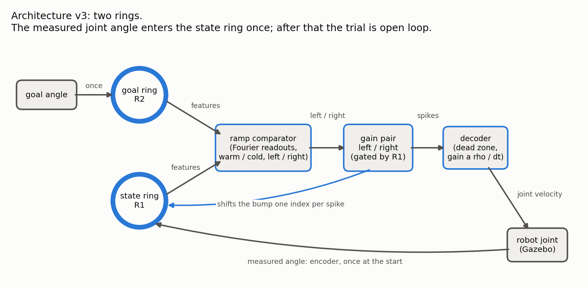
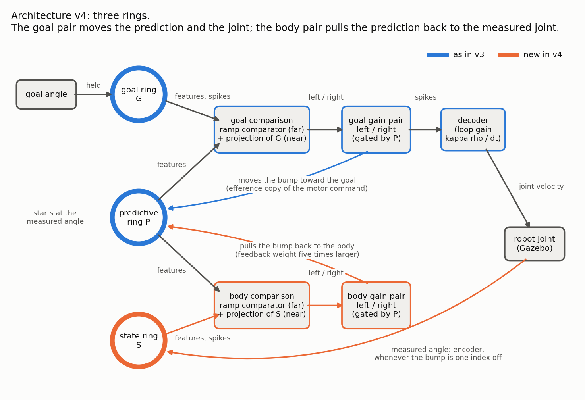
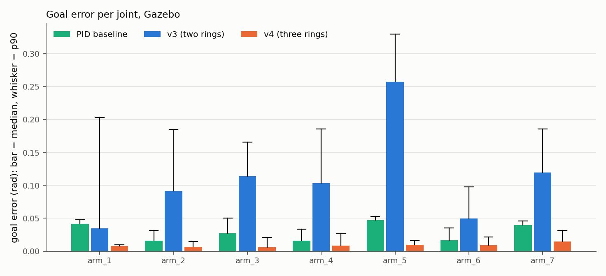

# TIAGo ring-attractor controller

A spiking ring-attractor network (NEST) that drives the arm joints of a
simulated TIAGo (Gazebo, ROS Noetic). This page is the run manual: how to start
every version of the controller, change its speed, calibrate it, measure it and
record it. The last section says where everything is.

- The mathematics and derivations of every part: [`TECHNICAL.md`](TECHNICAL.md)
- What each version is made of: [`docs/architecture.md`](docs/architecture.md)
- How the versions compare (v3, v4, the PID baseline): [`docs/results.md`](docs/results.md)
- Stress test with random joints, arm poses and goals: [`docs/stress-test.md`](docs/stress-test.md)
- How v4 was tuned and validated: [`docs/v4-tuning.md`](docs/v4-tuning.md)
- Earlier variants and reports: [`docs/archive/`](docs/archive/README.md)

## 1. The versions

| Version | What it is | Start it with |
| --- | --- | --- |
| **v4** (current) | Three rings: goal, predictive, state. The joint encoders are fed back all the time; the goal comparison keeps commanding until the body has arrived | `--template three_ring_single_joint` |
| **v3, bounded ring** | Two rings (goal, state), the joint read once. Joint range on an arc of the ring, limits enforced, 3 NEST steps per robot tick | `--template two_ring_single_joint --bounds bounded` |
| **Original scripts** | The frozen code behind the draft's figures | `scripts/run_legacy_trials.py --controller ring` |

What v3 and v4 are measured against:

| | What it is | Start it with |
| --- | --- | --- |
| **PID baseline** | The PID of the draft: a three-term PID with fixed gains (kp 2.0, ki 0.1, kd 0.05, 0.5 rad/s limit), the same for every joint | `scripts/run_legacy_trials.py --controller pid` |

Earlier variants (v3 on the legacy ring with hand-set or transport-calibrated
gains, runs at one NEST step per tick) still run (section 3.3); their results
are in [`docs/archive/`](docs/archive/README.md).

v3 and v4 as they are built (drawn by `scripts/draw_architecture.py`):




### What was compared, and the result

Everything below is measured in Gazebo with the same rules for every system:
the same goals, a 50 ms sample time, the reset motion before every trial, and
one scoring function. Errors are |goal - final joint angle| in rad, as
median / p90. Full account: [`docs/results.md`](docs/results.md).

| Test | What was done | Original scripts | v3 | PID baseline | v4 |
| --- | --- | --- | --- | --- | --- |
| **Comparison** | all 7 arm joints, 8 goals each from the reset pose: 56 trials per system | 0.260 / 0.796 | 0.091 / 0.257 | 0.027 / 0.048 | **0.008 / 0.022** |
| Trials settled within 0.05 rad | the same 56 trials | 29% | 54% | 100% | 100% |
| Settling time, median | the same 56 trials | 13.30 s | 2.85 s | 2.23 s | 2.35 s |
| **Robustness**: motor gain x0.7 | arm_2, arm_5, arm_6, 18 trials: the joint moves 30% less than commanded | - | 0.314 / 0.662 | 0.033 / 0.056 | 0.013 / 0.028 |
| Robustness: motor gain x1.3 | the joint moves 30% more than commanded | - | 0.203 / 0.855 | 0.017 / 0.046 | 0.010 / 0.022 |
| Robustness: push | the joint is displaced 0.2 rad one second into the move | - | 0.234 / 0.373 | 0.022 / 0.048 | 0.009 / 0.020 |
| Robustness: hold | the joint is held for 2 s during the move | - | 0.533 / 1.530 | 0.041 / 0.055 | 0.007 / 0.023 |
| **Repeatability** | three runs of the same goal, 8 goals: median range of the end point | 0.0005 | 0.0003 | 0.0001 | 0.0133 |
| **Stress test** | 300 random trials: a random joint, the whole arm in a random pose, a random goal ([`docs/stress-test.md`](docs/stress-test.md)) | - | 0.081 / 0.204 | 0.019 / 0.049 | 0.012 / 0.033 |

In words:

- **v4 against v3:** about 11 times less error; v4 settles every trial, v3
  about half; under every disturbance v4 still arrives and v3 does not.
- **v4 against the PID baseline:** v4 ends closer to the goal in the
  comparison, under every disturbance and in the stress test, and settles as
  fast. The PID baseline repeats a goal more exactly, and in the stress test
  it is the more accurate one on short moves.
- **v4 needs no motor calibration**; v3's accuracy depends on one.
- v3 and v4 were also run on NEST with a simulated joint (504 trials each:
  v3 0.063 / 0.194, v4 0.011 / 0.027). The PID baseline and the original
  scripts only exist as Gazebo scripts.



## 2. Setup

Everything runs in one Docker image (ROS Noetic, Gazebo 11, NEST, the TIAGo
simulation; about 20 GB, pinned in `docker/image.env`). Nothing is installed on
the host. Requirements: Linux amd64 and Docker usable by your user; for a
Gazebo window or camera recordings also a desktop session with `xauth` and an
NVIDIA GPU.

There are two ways in. Use the first to work interactively (Gazebo window,
dashboard in the browser), the second for experiments that run on their own.

### 2.1 Interactive container

```bash
./run_model_docker.bash --name tiago-ring              # desktop + GPU
./run_model_docker.bash --name tiago-ring --software   # desktop, software rendering
./run_model_docker.bash --name tiago-ring --headless   # no window
```

This pulls the image the first time, builds the package and gives you a shell
inside the container, in the package's `src/` folder. In that shell:

```bash
roslaunch tiago_ring_controller tiago_ring_controller.launch          # add gui:=false for no window
```

Wait until the arm has moved to its start pose. Open more terminals in the
same container from the host with:

```bash
docker exec --user "$(id -u):$(id -g)" -it --workdir /tiago_public_ws/src/tiago_ring_controller \
  tiago-ring bash --rcfile /model_repo/docker/bashrc -i
```

### 2.2 Batch containers (no desktop needed)

`docker/batch.bash` starts throwaway containers without network, so several
can run side by side.

```bash
# NEST with a simulated (fake) robot: one command, then the container is gone
docker/batch.bash nest -- 'python3 -B scripts/run_graph.py --template three_ring_single_joint --engines nest --goal 0.6'
docker/batch.bash nest --out /tmp/results -- 'python3 -B scripts/validate_velocity.py --engines nest --systems B F --joints 5 --out /out'

# Gazebo in the background (about 50 s to come up), commands against it, stop it
docker/batch.bash up sim1 --out /tmp/results
docker/batch.bash exec sim1 -- 'python3 -B scripts/run_graph.py --template three_ring_single_joint --engines full --goal 0.8'
docker/batch.bash down sim1
```

`--out DIR` mounts a host directory at `/out`. The package is mounted
read-only; add `--rw` to `nest` for the few commands that write into it
(installing a calibration, regenerating example files). `up NAME --gpu` renders
with the GPU, which only the recording camera needs (section 7).
`up NAME --world tiago_ring_stress` starts the world without the table
(section 6.1).

### 2.3 Conventions for every command below

- **Every command below can be pasted into a terminal at the root of this repo as it
  stands.** Results appear on the host in `/tmp/ring-so2` (inside the container that
  folder is `/out`).
- Commands that start with `docker/batch.bash nest` need nothing else.
- Commands that start with `docker/batch.bash exec sim1` drive the robot in Gazebo.
  Start that simulation once before them, and stop it when you are done:

  ```bash
  docker/batch.bash up sim1 --out /tmp/ring-so2      # about 50 s until it is ready
  docker/batch.bash down sim1                        # afterwards
  ```

- If you work in the interactive container (2.1) instead, paste only the part between
  the quotes into its shell; `/out` does not exist there, so give another `--out` folder.
- Commands run in the package root, `/tiago_public_ws/src/tiago_ring_controller`.
- Always `python3 -B`, so no bytecode is written into the mounted package.
- `--engines` picks the simulators: `fake` (no NEST, no robot: only checks that
  a graph runs), `nest` (real NEST, a simple simulated joint), `full` (real
  NEST and Gazebo; the simulation must be running).
- Joints are numbered 0 to 6 for `arm_1_joint` to `arm_7_joint`. Angles are in
  radians.

## 3. Run each version

### 3.1 v4: three rings with body feedback

```bash
docker/batch.bash nest --out /tmp/ring-so2 -- 'python3 -B scripts/run_graph.py --template three_ring_single_joint --joint 5 --engines nest --goal 0.8 --goal -1.0'
docker/batch.bash exec sim1 -- 'python3 -B scripts/run_graph.py --template three_ring_single_joint --joint 5 --engines full --goal 0.8 --out /out/v4'
```

Each trial prints start, goal, final angle and error. `--out DIR` writes
`trials_summary.csv`, one `.npz` and one `trial_XXXX_cosim.json` per trial
(every tick's spikes, ring counts, commands and joint states).
Change a setting for one run with `--feedback key=value` (the keys are in
[`docs/architecture.md`](docs/architecture.md)):

```bash
docker/batch.bash nest --out /tmp/ring-so2 -- 'python3 -B scripts/run_graph.py --template three_ring_single_joint --engines nest --goal 0.8 --feedback motor_gain=0.004 --feedback tau_s=0.1'
```

### 3.2 v3 on the bounded ring

```bash
docker/batch.bash nest --out /tmp/ring-so2 -- 'python3 -B scripts/run_graph.py --template two_ring_single_joint --bounds bounded --joint 5 --engines nest --goal 0.8'   # 3 NEST steps per tick
docker/batch.bash nest --out /tmp/ring-so2 -- 'python3 -B scripts/run_graph.py --template two_ring_single_joint --bounds bounded --time-scale 1 --engines nest --goal 0.8'   # network time = robot time
```

### 3.3 v3 on the legacy ring (the draft's architecture; superseded)

```bash
docker/batch.bash nest --out /tmp/ring-so2 -- 'python3 -B scripts/run_graph.py --template two_ring_single_joint --engines nest --goal 0.6'   # gains from the transport calibration
docker/batch.bash nest --out /tmp/ring-so2 -- 'python3 -B scripts/run_graph.py --template two_ring_single_joint --calibration legacy --engines nest --goal 0.6'   # hand-set gains of velocity_calibration.json
docker/batch.bash nest --out /tmp/ring-so2 -- 'python3 -B scripts/run_graph.py --template multi_joint_two_ring --engines nest --goal 0.6'   # one circuit per joint, joints 5 and 6
```

### 3.4 The original scripts and the PID baseline

These need the simulation `sim1` (section 2.3; they have their own real-time loop and
no fake robot). The wrapper runs the frozen collectors unchanged, on goals you give or
on the goal plan the other systems use, and scores them with the same code:

```bash
docker/batch.bash exec sim1 -- 'python3 -B scripts/run_legacy_trials.py --controller ring --joint 5 --goals 0.8 -0.6 --out /out/original'
docker/batch.bash exec sim1 -- 'python3 -B scripts/run_legacy_trials.py --controller pid  --joint 5 --goals 0.8 -0.6 --out /out/pid'
docker/batch.bash exec sim1 -- 'python3 -B scripts/run_legacy_trials.py --controller pid  --joint 5 --plan 8 --screen-moveit --out /out/pid'   # the comparison's goals
```

The scripts themselves are in `legacy/` and described in
[`docs/legacy.md`](docs/legacy.md). The PID baseline is the draft's script with
its fixed gains. The robustness options of section 6 (`--motor-gain-scale`,
`--push`, `--hold`) work here too; they are applied around the frozen script,
which is not changed:

```bash
docker/batch.bash exec sim1 -- 'python3 -B scripts/run_legacy_trials.py --controller pid --joint 5 --plan 6 --screen-moveit --motor-gain-scale 0.7 --out /out/pid_gain07'
docker/batch.bash exec sim1 -- 'python3 -B scripts/run_legacy_trials.py --controller pid --joint 5 --plan 6 --screen-moveit --push 0.2 --out /out/pid_push'
```

### 3.5 With the dashboard and the graph editor

The dashboard is a web page, so this one runs in the interactive container (2.1; it has
host networking). Start that container, run the `roslaunch` line of 2.1 in its shell,
open a second shell with the `docker exec` line of 2.1, and paste there:

```bash
python3 -B scripts/run_graph.py --template three_ring_single_joint --engines full --dashboard --out /tmp/session
```

- <http://localhost:8765/>: the trial page. Ring activity, raster, gain counts
  and the joint against the goal, live. *Start trial* with a goal in radians,
  *Stop*, *Reset now*.
- <http://localhost:8765/editor>: the graph editor. Blocks, their parameters
  and the wiring; *Load example*, *Validate*, *Save*, *Run in session*.

It also works without Gazebo (`--engines nest`). Trials run only when started
from the page; Ctrl-C ends the session.

### 3.6 A graph file instead of a template

Every version is a graph of blocks. Save one, edit the JSON (or use the
editor), run it:

```bash
docker/batch.bash nest --out /tmp/ring-so2 -- 'python3 -B scripts/run_graph.py --template three_ring_single_joint --joint 3 --save /out/my_v4.graph.json'
docker/batch.bash nest --out /tmp/ring-so2 -- 'python3 -B scripts/run_graph.py /out/my_v4.graph.json --validate'
docker/batch.bash nest --out /tmp/ring-so2 -- 'python3 -B scripts/run_graph.py /out/my_v4.graph.json --engines nest --goal 0.5'
```

A graph run commands every `Joint` block in the file, so check them before
`--engines full`. Ready-made files: `src/tiago_ring_controller/graph/examples/`.
From Python:

```python
from tiago_ring_controller.graph import run_graph, three_ring_single_joint

graph = three_ring_single_joint(joint=5, feedback={"motor_gain": 0.004})
results = run_graph(graph, engines="nest", goals=[0.6, -0.5], out_dir="/tmp/exp")
record = results[0]["record"]          # every tick's datapacks
```

## 4. Change the speed

| What you want | Do this | Notes |
| --- | --- | --- |
| Faster or slower joints, v3 or v4 | `--time-scale K` (1, 2, 3, ...) | K NEST steps per robot tick. The network does the same, the joint moves K times as fast. Default 3 for v4 and the bounded v3, 1 for the legacy ring |
| Make that the default | `time_scale` in `FEEDBACK` (v4) or `BOUNDED` (v3) in `graph/templates.py` | |
| In a graph file | `simulation.time_scale`, and multiply the decoder's `dead_zone` and `drive_threshold` by the same factor | the templates do this for you |
| v4 only: a little faster or gentler | `--feedback motor_gain=0.006` (default 0.005266) | a loop gain; ±30% leaves the accuracy where it is |
| The speed limit | `ARM_MAX_VELOCITY` in `graph/templates.py` (the limits of the robot description) | commands are clipped to it; clipped ticks are counted as `clamp_ticks` |

```bash
docker/batch.bash nest --out /tmp/ring-so2 -- 'python3 -B scripts/run_graph.py --template three_ring_single_joint --time-scale 1 --engines nest --goal 0.8'   # slow
docker/batch.bash nest --out /tmp/ring-so2 -- 'python3 -B scripts/run_graph.py --template three_ring_single_joint --time-scale 3 --engines nest --goal 0.8'   # default
```

Measured (Gazebo, time to cover 90% of a move, median): v4 1.88 s and v3 2.33 s
at 3x; the PID baseline 2.10 s; the original scripts 12.07 s. Earlier runs at
1x: v4 5.60 s, v3 6.70 s (`docs/archive/`).
Background and measurements: [`docs/archive/velocity/speed.md`](docs/archive/velocity/speed.md).

## 5. Calibrate

| Version | What needs calibrating | When to redo it |
| --- | --- | --- |
| v4 | Nothing. The decoder gain is a loop gain; the comparator weights are shared with v3 (bounded) | the ring size or the arc changes: refit the comparator (5.1) |
| v3, bounded ring | Comparator weights (5.1) and the transport calibration (5.2) | any ring, comparator or gain parameter changes |
| v3, legacy ring | Transport calibration (5.2) | any ring, comparator or gain parameter changes |
| any, on a new robot | Actuator check (5.3) | once per robot or controller |

Results go to `--out` first. `--install` copies an artifact into `src/config/`, which
needs a writable package (the `--rw` in the commands that install), and the artifact
must then be registered (5.4). To install the bounded transport calibration, add
`--install` to its command in 5.2 and `--rw` after `nest`.

### 5.1 Comparator weights (which way is the goal)

```bash
docker/batch.bash nest --out /tmp/ring-so2 -- 'python3 -B scripts/fit_comparator.py collect --out /out/cmp'   # bump at every position, about 30 s
docker/batch.bash nest --rw --out /tmp/ring-so2 -- 'python3 -B scripts/fit_comparator.py fit --library /out/cmp --rise-fraction 0.8 --arc-fraction 0.7 --name N_200_bounded_a070 --out /out/cmp --install'
docker/batch.bash nest --out /tmp/ring-so2 -- 'python3 -B scripts/fit_comparator.py map --bounds bounded --out /out/cmp/map'   # decisions over all start/goal pairs: wrong signs, dead zones
docker/batch.bash nest --out /tmp/ring-so2 -- 'python3 -B scripts/fit_comparator.py map --fine --bounds bounded --out /out/cmp/fine'   # goal offsets of one index: the blind band of the comparator alone
docker/batch.bash nest --out /tmp/ring-so2 -- 'python3 -B scripts/fit_comparator.py map --fine --sharp --bounds bounded --out /out/cmp/sharp'   # the same with v4's projection
docker/batch.bash nest --out /tmp/ring-so2 -- 'python3 -B scripts/fit_comparator.py drift --bounds bounded --out /out/cmp/drift'   # how far a free bump wanders in 20 s
```

### 5.2 Transport calibration (v3: joint velocity per gain spike)

```bash
docker/batch.bash nest --out /tmp/ring-so2 -- 'python3 -B scripts/calibrate_transport.py --template two_ring_single_joint --out /out/cal'   # legacy ring
docker/batch.bash nest --out /tmp/ring-so2 -- 'python3 -B scripts/calibrate_transport.py --bounds bounded --starts 45 70 95 120 145 --goals 45 70 95 120 145 155 --out /out/cal_bounded'   # bounded ring
```

It runs the network on NEST for start/goal pairs, fits "one gain spike moves
the bump `a` indices, above a dead zone of `theta` spikes per tick", and
writes `transport_calibration*.json`. The decoder gain of a joint is then
`a * rho / dt` with `rho` its radians per index. A graph whose network no
longer matches the calibrated one prints a warning when run. Method and
numbers: [`docs/archive/velocity/calibration.md`](docs/archive/velocity/calibration.md).

### 5.3 Actuator check (does the joint do what it is commanded)

```bash
docker/batch.bash exec sim1 -- 'python3 -B scripts/identify_actuator.py --joints 5 4 --out /out/actuator.json'   # Gazebo
```

Commands velocity steps and reports commanded against measured displacement
and the lag. In Gazebo the ratio is 1.00 and the lag 5-14 ms.

### 5.4 Register an installed artifact

Every file under `src/config/` is pinned by size, hash and schema. After
`--install`:

```bash
docker/batch.bash nest --rw --out /tmp/ring-so2 -- 'python3 -B scripts/update_artifact_manifest.py src/config/calibration/transport_calibration_bounded.json'
docker/batch.bash nest -- 'cd test && python3 -B -m unittest test_artifact_contracts'     # must pass again
```

### 5.5 Check a setting of v4

v4 has no fit, but its settings can be checked in about two minutes on NEST:

```bash
docker/batch.bash nest --out /tmp/ring-so2 -- 'python3 -B scripts/validate_velocity.py --engines nest --systems F --joints 5 4 --starts 0.2 0.5 0.8 --trials 6'
docker/batch.bash nest --out /tmp/ring-so2 -- 'python3 -B scripts/validate_velocity.py --engines nest --systems F --joints 5 4 --starts 0.2 0.5 0.8 --trials 6 --feedback body_feedback_weight=-2.0'
docker/batch.bash nest --out /tmp/ring-so2 -- 'python3 -B scripts/validate_velocity.py --engines nest --systems F --joints 5 --trials 8 --motor-gain-scale 0.7'   # a motor gain that is 30% low
```

What to look at in the output: goal error, bumps lost (must be 0), and
"predicted - state" (how far the prediction ends from the body, in ring
indices). How the defaults were found: [`docs/v4-tuning.md`](docs/v4-tuning.md).

## 6. Measure and compare

`scripts/validate_velocity.py` runs the graph systems on the same starts and
goals and scores them. Systems: `B` (v3, bounded ring), `F` (v4), and the
superseded `G` and `T` (v3 on the legacy ring with hand-set or
transport-calibrated gains).

```bash
docker/batch.bash nest --out /tmp/ring-so2 -- 'python3 -B scripts/validate_velocity.py --engines nest --systems B F --joints 5 4 --trials 8 --out /out/quick'   # NEST, about 2 min
docker/batch.bash exec sim1 -- 'python3 -B scripts/validate_velocity.py --engines full --systems B F --joints 0 1 2 3 4 5 6 --trials 8 --screen-moveit --out /out/gazebo'
```

| Option | Meaning |
| --- | --- |
| `--trials N` | goals per joint, spread over both sides of the start |
| `--starts 0.25 0.5 0.75` | start poses as fractions of the joint range (default: the reset pose) |
| `--seeds 13579 7 99` | network seeds |
| `--repeats 3` | runs of every trial (repeatability) |
| `--time-scale K` | speed (section 4) |
| `--set key=value`, `--feedback key=value` | a bounded-ring (`BOUNDED`) or v4 (`FEEDBACK`) setting |
| `--motor-gain-scale 0.7` | the decoder gain is wrong by this factor |
| `--push 0.2`, `--hold 2`, `--disturb-at 1.0` | the joint is displaced by 0.2 rad, or held for 2 s, one second into the trial, without the network being told |
| `--screen-moveit` | Gazebo: skip goals MoveIt reports in collision |

The whole comparison of [`docs/results.md`](docs/results.md) is these calls
(the simulation `sim1` of section 2.3 running; results in `/tmp/ring-so2/compare`):

```bash
docker/batch.bash exec sim1 -- 'for j in 0 1 2 3 4 5 6; do python3 -B scripts/run_legacy_trials.py --controller ring --joint $j --plan 8 --screen-moveit --out /out/compare/legacy; done'
docker/batch.bash exec sim1 -- 'for j in 0 1 2 3 4 5 6; do python3 -B scripts/run_legacy_trials.py --controller pid --joint $j --plan 8 --screen-moveit --out /out/compare/pid; done'
docker/batch.bash exec sim1 -- 'python3 -B scripts/validate_velocity.py --engines full --joints 0 1 2 3 4 5 6 --trials 8 --screen-moveit --systems B --out /out/compare/b3'
docker/batch.bash exec sim1 -- 'python3 -B scripts/validate_velocity.py --engines full --joints 0 1 2 3 4 5 6 --trials 8 --screen-moveit --systems F --out /out/compare/f3'
docker/batch.bash nest --out /tmp/ring-so2 -- 'python3 -B scripts/results_report.py --data /out --out /out/report'      # tables.md and figures
```

The robustness tests are the same calls with a disturbance, on arm_2, arm_5
and arm_6 (repeat with `--motor-gain-scale 1.3`, `--push 0.2`, `--hold 2`, and
without any for the nominal set):

```bash
docker/batch.bash exec sim1 -- 'python3 -B scripts/validate_velocity.py --engines full --joints 1 4 5 --systems B F --trials 6 --screen-moveit --motor-gain-scale 0.7 --out /out/robust/mg07'
docker/batch.bash exec sim1 -- 'for j in 1 4 5; do python3 -B scripts/run_legacy_trials.py --controller pid --joint $j --plan 6 --screen-moveit --motor-gain-scale 0.7 --out /out/robust/mg07_pid; done'
```

`results_report.py` reads `compare/` (above), and when present `repeat/`,
`robust/`, `nest/` and `measure/`; the layout is in
`docs/results/data/README.md`. To regenerate the published tables and figures
from the stored data:

```bash
docker/batch.bash nest --out docs/results -- 'python3 -B scripts/results_report.py --data /out/data --out /out && python3 -B scripts/draw_architecture.py --out /out/paper'
```

### 6.1 Stress test: random joint, random arm pose, random goal

`scripts/stress_test.py` draws trials from a seed (a joint 0-6, a start and a
goal anywhere in its range, the other six joints at random angles), runs any
system on exactly those trials, and draws bar plots and heat maps of the
errors. Results and reading: [`docs/stress-test.md`](docs/stress-test.md).

```bash
# 1. NEST (simulated joints; the pose of the other joints has no effect here)
docker/batch.bash nest --out /tmp/stress -- 'python3 -B scripts/stress_test.py plan --trials 2100 --seed 1 --out /out/nest_plan.json'
docker/batch.bash nest --out /tmp/stress -- 'python3 -B scripts/stress_test.py run --plan /out/nest_plan.json --system F --engines nest --out /out/nest_v4'
docker/batch.bash nest --out /tmp/stress -- 'python3 -B scripts/stress_test.py run --plan /out/nest_plan.json --system B --engines nest --out /out/nest_v3'

# 2. Gazebo, in the world without the table (random arm poses would hit it)
docker/batch.bash up sim1 --world tiago_ring_stress --out /tmp/stress
docker/batch.bash exec sim1 -- 'python3 -B scripts/stress_test.py plan --trials 300 --seed 1 --screen-moveit --out /out/gazebo_plan.json'
docker/batch.bash exec sim1 -- 'python3 -B scripts/stress_test.py run --plan /out/gazebo_plan.json --system F   --engines full --out /out/gazebo_v4'
docker/batch.bash exec sim1 -- 'python3 -B scripts/stress_test.py run --plan /out/gazebo_plan.json --system B   --engines full --out /out/gazebo_v3'
docker/batch.bash exec sim1 -- 'python3 -B scripts/stress_test.py run --plan /out/gazebo_plan.json --system PID --engines full --out /out/gazebo_pid'
docker/batch.bash down sim1

# 3. tables.md and figures/ (bars per joint and per move distance, two heat maps, per simulator)
docker/batch.bash nest --out /tmp/stress -- 'python3 -B scripts/stress_test.py report --data /out --out /out/report'
```

- `--screen-moveit` rejects draws that MoveIt reports in self-collision and
  draws again. The result folders must be named `nest_<v3|v4>` and
  `gazebo_<pid|v3|v4>` for the report to find them.
- A run writes after every trial and skips finished trials: rerun the same
  command to resume. To use several simulations at once give each a share of
  the plan and the same `--out`: `--shard 1/2` in one, `--shard 2/2` in the
  other (300 Gazebo trials take about 2.5 hours in one simulation).
- `--limit 10` runs only the first trials (a quick check); `--seed` in `plan`
  gives a different random set; `--time-scale` as everywhere.
- To rerun one trial, look it up in the plan file by its `id` (the report lists
  the ten worst): its `joint`, `pose`, `goal_rad` and `seed` are all there.

Every Gazebo trial starts with the reset motion and with the robot's mobile
base put back at its spawn pose: the base is not anchored, and an arm that
pushes on the table shoves it. Each trial records how far the base moved
(`base_shift_m`).

## 7. Record videos

The overhead camera of the world only renders with a GPU:

```bash
docker/batch.bash up cam --gpu --out /tmp/videos
docker/batch.bash exec cam -- 'python3 -B scripts/record_video.py trial --system F --joint 5 --goal -0.992 --out /out/v4_arm6.mp4'
docker/batch.bash exec cam -- 'python3 -B scripts/record_video.py trial --system B --joint 5 --goal -0.992 --out /out/v3_arm6.mp4'
docker/batch.bash exec cam -- 'python3 -B scripts/record_video.py grid --columns 2 --out /out/v3_vs_v4_arm6.mp4 /out/v3_arm6.mp4 /out/v4_arm6.mp4'
docker/batch.bash down cam
```

`--system` is `G`, `T`, `B`, `F`, `L` (original scripts) or `PID`; the
disturbance options of section 6 work here too. Each frame carries the joint,
the goal, what the rings read and the gain spikes. The recordings of the
results page: `docs/results/videos/`.

## 8. Tests

```bash
docker/batch.bash nest -- 'python3 -B -m unittest discover -s test -p "test_*.py"'       # everything, with real NEST: about 4 min
docker/batch.bash nest -- 'cd test && python3 -B -m unittest test_feedback_v4'            # one module
```

On a host with NumPy the tests that need neither NEST nor ROS run directly
(`cd src/tiago_ring_controller && python3 -B -m unittest discover -s test`);
the real-NEST tests skip unless the pinned NEST (`HEAD@41892a5`) is present.

## 9. When something goes wrong

| Symptom | Cause and fix |
| --- | --- |
| `play_motion ... ended in state ABORTED` or `REJECTED` | The reset motion could not be planned from where the arm was, or another process is still commanding the robot. The engine retries twice (it first drives the arm straight back); `validate_velocity.py` records the trial as failed and goes on. If every trial fails, look for a second script still running in the container |
| Nothing moves, `/joint_states` is silent | Physics is paused (a killed script leaves it paused): `rosservice call /gazebo/unpause_physics` |
| A joint stops at the same angle whatever the goal | It is pushing on the table. Check `base_shift_m` of the trial; goals are screened by MoveIt for self-collision only |
| `note: decoder ... the transport calibration prescribes ...` | A v3 graph whose decoder does not use the calibration (for example `--calibration legacy`). Information, not an error |
| `WARNING: decoder uses the transport calibration, but the network parameters differ` | You changed the network: redo 5.2 |
| The dashboard page does not load | The batch containers have no network: use the interactive container (2.1) |
| `Address already in use` (8765) | Another dashboard is running: `--dashboard-port 8766` |
| A trial runs to 400 steps although the joint has arrived | The motor drive stayed just above the "settled" threshold. The joint is still (`hold_range_rad`); only the trial is longer |
| Tests fail with a stale `*.graph.json` | A template changed: `docker/batch.bash nest --rw -- 'python3 -B -c "from tiago_ring_controller.graph.templates import write_examples; write_examples()"'` |

## 10. Changing the model

- **Parameters or wiring only:** a graph file or the editor (3.6), or the
  settings dictionaries `BOUNDED` and `FEEDBACK` in `graph/templates.py`.
- **A new architecture from existing blocks:** a template function in
  `graph/templates.py` (only `Graph.add` and `Graph.connect`), registered in
  `TEMPLATES`; regenerate the examples; add a test on the fakes and a real-NEST
  gate.
- **A new block type:** [`docs/blocks/adding-a-block.md`](docs/blocks/adding-a-block.md).
- **The science of an existing block** (weights, neuron parameters, feedback
  rules) needs an equivalence gate: [`docs/blocks/equivalence.md`](docs/blocks/equivalence.md).
- After changing block parameters or ports, regenerate the block reference:
  `docker/batch.bash nest --out docs/blocks -- 'python3 -B scripts/write_block_reference.py /out/blocks.md'`.

## 11. Status

Branch `velocity-calibration`, not merged. Container suite: 340 tests pass, 3 are skipped (2026-10-04).
Measured in Gazebo on all seven joints: every system of section 1
([`docs/results.md`](docs/results.md)). Open items:

- v4 is exact to about one ring index (0.02-0.03 rad) and repeats a goal to the
  same. A finer answer needs more neurons per radian. At `--time-scale 1` some
  v4 trials stop up to 0.14 rad short; use 2 or 3.
- The PID baseline has one fixed set of gains for all joints (the draft's); it
  was not optimised per joint.
- The multi-joint template is still v3 on the legacy ring; v4 exists for one
  joint per network.
- In the default simulated world the table is within reach of the arm and
  MoveIt screens goals for self-collision only. Trials log `base_shift_m` when
  the arm pushed on something.
- Nothing has been run on the real robot. Before that: lower the velocity limit
  (v4 commands up to 1.7 rad/s at 3x) and read
  `src/tiago_ring_controller/docs/robot_safety.md`.
- The dashboard ran a v4 trial against Gazebo through its HTTP interface; the
  browser pages themselves were not looked at in this work.
- The paper draft describes v3. `docs/results/paper/` holds the figures, the
  v4 diagram and the numbers for an update; the draft was not edited.
- `TaskGain` is a stub.

## 12. Contributing

- `main` is the frozen baseline behind the published results (tag
  `legacy-loop-baseline`); nothing is committed to it directly.
- New work goes on a feature branch; put its design and measurements in `docs/`
  on the same branch.
- Before a pull request: the container suite green (section 8); new behaviour
  covered by a test on the fakes and, when NEST is involved, a real-NEST gate
  with a stated tolerance; any Gazebo run recorded in the relevant document
  with its actual output.
- The files in `legacy/` and the calibration `velocity_calibration.json` are
  frozen. Scientific changes need a re-baselined golden and an entry in
  `docs/blocks/equivalence.md`.

## 13. Where things are

Code paths are relative to `src/tiago_ring_controller/`; `pkg/` stands for
`src/tiago_ring_controller/src/tiago_ring_controller/`.

| Topic | Code | Document | Data |
| --- | --- | --- | --- |
| The versions, what each part does | `pkg/graph/templates.py` | [`docs/architecture.md`](docs/architecture.md) | - |
| v4: three rings, body feedback | `pkg/blocks/composites.py` (`JointTriple`), `pkg/blocks/gain.py` (`reference` port), `pkg/nest/populations.py` (`connect_gain_reference`) | [`docs/v4-tuning.md`](docs/v4-tuning.md) | `docs/results/data/` |
| v3 bounded ring, reading the joint off the ring | `pkg/blocks/ring.py`, `pkg/blocks/state.py`, `pkg/control/mapping.py` | [`docs/archive/velocity/bounded-ring.md`](docs/archive/velocity/bounded-ring.md) | `docs/archive/velocity/media/bounded/` |
| Speed (`time_scale`) | `pkg/cosim/graph_engine.py`, `pkg/graph/graph.py` | [`docs/archive/velocity/speed.md`](docs/archive/velocity/speed.md) | `docs/archive/velocity/media/speed/` |
| Spikes to joint velocity, transport calibration | `pkg/blocks/decoder.py`, `pkg/graph/calibration.py`, `pkg/training/transport.py`, `scripts/calibrate_transport.py`, `scripts/identify_actuator.py` | [`docs/archive/velocity/calibration.md`](docs/archive/velocity/calibration.md) | `src/config/calibration/` |
| Comparator fit, decision maps, drift | `pkg/training/comparator.py`, `scripts/fit_comparator.py` | [`docs/archive/velocity/bounded-ring.md`](docs/archive/velocity/bounded-ring.md), [`docs/v4-tuning.md`](docs/v4-tuning.md) | `src/config/homeostasis/`, `docs/results/data/measure/` |
| PID baseline (the PID of the draft) | `legacy/single_joint_pid_data_collector.py`, `scripts/run_legacy_trials.py`, `pkg/control/controller.py` (`PIDControllerCore`) | [`docs/results.md`](docs/results.md) | `docs/results/data/compare/pid_trials_j*.json` |
| Comparison of every system | `scripts/validate_velocity.py`, `scripts/run_legacy_trials.py`, `scripts/results_report.py`, `scripts/check_doc_numbers.py`, `pkg/evaluation/motion.py` | [`docs/results.md`](docs/results.md), [`docs/results/tables.md`](docs/results/tables.md) | `docs/results/data/`, `docs/results/figures/` |
| Paper figures and diagrams | `scripts/results_report.py`, `scripts/draw_architecture.py` | [`docs/results.md`](docs/results.md) | `docs/results/paper/` |
| Videos | `scripts/record_video.py` | [`docs/results.md`](docs/results.md) | `docs/results/videos/` |
| Stress test (random joint, pose and goal) | `scripts/stress_test.py`, `overrides/pal_gazebo_worlds/worlds/tiago_ring_stress.world` | [`docs/stress-test.md`](docs/stress-test.md) | `docs/results/data/stress/`, `docs/results/stress/` |
| Disturbances (push, hold, wrong motor gain) | `pkg/cosim/disturbance.py` | [`docs/v4-tuning.md`](docs/v4-tuning.md) | `docs/results/data/robust/` |
| Blocks, ports, parameters | `pkg/blocks/` | [`docs/blocks/blocks.md`](docs/blocks/blocks.md) (generated), [`docs/blocks/architecture.md`](docs/blocks/architecture.md) | - |
| Graph files and the editor | `pkg/graph/`, `pkg/ui/`, `scripts/run_graph.py` | [`docs/blocks/graph-schema.md`](docs/blocks/graph-schema.md) | `pkg/graph/examples/` |
| The lock-stepped loop, Gazebo engine, dashboard | `pkg/cosim/` | [`docs/cosim/README.md`](docs/cosim/README.md) | - |
| NEST builders | `pkg/nest/` | [`docs/blocks/equivalence.md`](docs/blocks/equivalence.md) | - |
| Original scripts | `legacy/` | [`docs/legacy.md`](docs/legacy.md) | - |
| Scientific inputs (neuron parameters, fitted weights, calibrations) | `src/config/`, `scripts/update_artifact_manifest.py`, `test/test_artifact_contracts.py` | `src/tiago_ring_controller/docs/artifacts.md` | `src/config/` |
| Containers | `run_model_docker.bash`, `docker/batch.bash`, `docker/`, `overrides/` | this page, section 2 | - |
| Robot safety | - | `src/tiago_ring_controller/docs/robot_safety.md` | - |
| Earlier reports, variants, plans and progress logs | `scripts/archive/` | [`docs/archive/`](docs/archive/README.md) | `docs/archive/results-data/`, `docs/archive/velocity/media/` |
| Tests | `test/` | section 8 | `test/golden/` |
