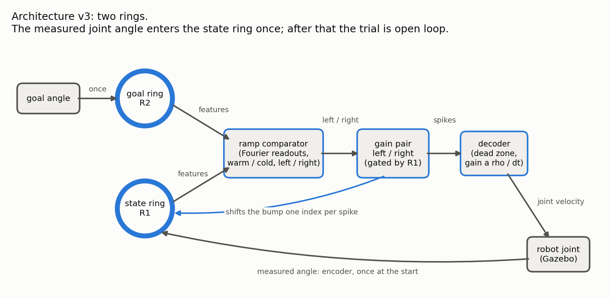
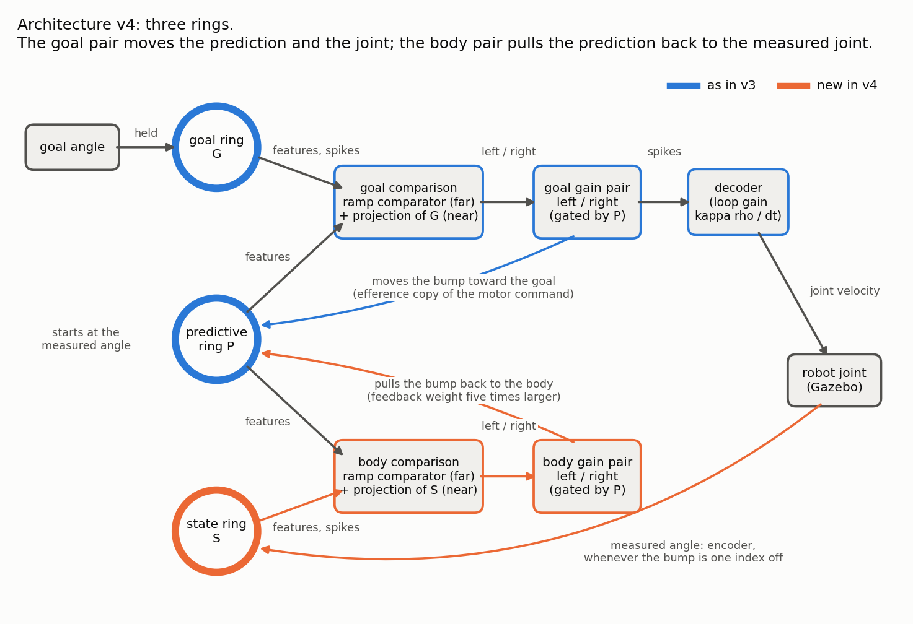

# The model: architecture v3 (two rings) and v4 (three rings)

This page says what each version is made of, what every part does, and which
parameter sets it. How to run them is in the top-level [`README.md`](../README.md);
how well they do is in [`results.md`](results.md). The code layers (blocks, graph,
loop) are mapped in [`blocks/architecture.md`](blocks/architecture.md).

## The versions

| Version | Rings | How the joint is fed back | Template (`graph/templates.py`) | Status |
| --- | --- | --- | --- | --- |
| Original scripts | goal, state | once, at the start of a trial | none: `legacy/single_joint_data_collector.py` | frozen, kept for comparison |
| PID baseline | none | every tick (three-term PID, fixed gains) | none: `legacy/single_joint_pid_data_collector.py` | frozen, the draft's baseline |
| v3, legacy ring | goal, state | once | `two_ring_single_joint(bounds="legacy")` | reproduces the paper's architecture |
| v3, bounded ring | goal, state | once | `two_ring_single_joint(bounds="bounded")` | v3 with the limit and speed fixes |
| **v4** | goal, predictive, state | **all the time, through the state ring** | `three_ring_single_joint()` | current |

## Parts that every ring version shares

- **Ring.** 200 spiking neurons with local excitation and wider inhibition. It
  holds one bump of activity, about 28 neurons wide; the bump's position is the
  number the ring stores. Block `Ring`.
- **Joint angle to ring index.** *Legacy ring:* the joint range lies on indices
  5 to 195, so the two joint limits sit next to each other across the seam.
  *Bounded ring:* the joint range lies on 70% of the ring (indices 30 to 170),
  a wall (lower bias current outside indices 15 to 185) keeps bumps out of the
  rest, and the gain pair cannot push the bump past a limit. One index is
  `rho` radians: 0.020 rad for arm_6, 0.034 rad for the widest joints.
  Details: [`archive/velocity/bounded-ring.md`](archive/velocity/bounded-ring.md).
- **Encoder.** Poisson generators that put a bump at the index of an angle.
  Modes: `once` (first tick only), `continuous` (every tick), `corrective`
  (only while the bump is more than `dead_band` indices away from the angle).
- **Ramp comparator** (`FourierReadout` + `Homeostasis`). Each ring is read by
  40 Fourier feature neurons; fitted weights turn each ring's position into a
  firing rate that rises along the ring ("warm" for the ring being moved,
  "cold" for the reference); a left / right decision pair fires for whichever
  is higher. It sees the direction from far away, but it gives **no drive when
  the two bumps are closer than 6 to 10 indices** (measured: a blind band 10 to
  21 indices wide).
- **Gain pair** (`Gain`). Two populations of 200 neurons, "left" and "right".
  Neuron *i* fires when ring neuron *i* is active **and** its side won the
  decision. Each spike inhibits the ring neuron one step to the side, which
  shifts the bump one way. The spike count is also the motor signal.
- **Decoder.** `velocity = gain * filter(right spikes - left spikes - dead zone)`,
  clipped to the joint's velocity limit.
- **Loop.** NEST and the robot advance in ticks of 50 ms, lock-stepped, with one
  tick of delay between them. `time_scale = k` runs k NEST steps per robot
  tick: the network does the same thing spike for spike, the robot gets k
  times the spikes per tick and moves k times as fast
  ([`archive/velocity/speed.md`](archive/velocity/speed.md)).

## v3: two rings

One trial:

1. The goal angle is written into the goal ring once; the measured joint angle
   is written into the state ring once.
2. The ramp comparator compares the two bumps and picks left or right.
3. The winning gain population fires. Its spikes move the state bump toward
   the goal bump, and the decoder turns the same spikes into joint velocity.
4. When the bumps are close, the comparator falls silent and the trial ends.

The joint is never looked at again after step 1. The decoder gain is therefore
a calibration ("one gain spike moves the bump `a` indices, so command
`a * rho / dt`", [`archive/velocity/calibration.md`](archive/velocity/calibration.md)) and
every error stays: the comparator stopping early or late (median 3.1 indices),
the joint not following the bump exactly (median 1.5 indices), a bump that
drifts, a wrong motor gain, a push.

## v4: three rings

| Ring | Block id | Holds | Written by |
| --- | --- | --- | --- |
| G, goal ring | `jt__G` | where the joint should go | the goal encoder, whenever the bump is 2 indices off the goal |
| P, predictive ring | `jt__P` | where the joint is expected to be | the measured angle once at the start, then only the two gain pairs |
| S, state ring | `jt__S` | where the joint is | the joint encoders, whenever the bump is 1 index off the joint |

One tick:

1. **Goal comparison** (P against G). The ramp comparator gives the direction
   from far away. Near the goal the goal ring projects straight onto the goal
   gain pair (below), which removes the blind band.
2. **The goal gain pair fires.** Its spikes do two things: they move P toward
   the goal, and the decoder turns them into joint velocity. P therefore moves
   as the joint is *told* to move: it is the prediction (an efference copy).
3. **The joint moves** and its measured angle moves S.
4. **Body comparison** (P against S), built like the goal comparison. Its gain
   pair moves P back toward S and commands nothing. Its feedback weight is five
   times that of the goal pair (-3.0 against -0.6), so the prediction cannot
   run away from the body.
5. If the joint did less than commanded (weak motor, held, pushed back), P is
   pulled back, the goal comparison sees that P has not arrived, and keeps
   commanding. If the joint did more, P is pulled past and the goal pair
   commands the other way. The goal comparison only falls silent when the
   **body** is at the goal.

This is the "competition" of your v4 drawing, with one decision made
differently, on purpose: the two comparisons compete over the predictive bump,
but only the goal pair drives the robot. If one merged signal moved both the
bump and the robot, they would always move together and a difference between
prediction and body could never shrink.

### The projection of a ring onto a gain pair ("sharp comparison")

Gain neuron *i* of the "right" population (which moves the bump up) is excited
by the reference ring's neurons *i+1 … i+10* and inhibited by *i-10 … i-1*; the
"left" population is the mirror image. Where the two bumps overlap, excitation
and inhibition cancel; at the edge where the reference bump sticks out, the
side that leads toward it wins. The drive is proportional to the offset and
works down to one index. Measured blind band: 0 to 1 index, against 10 to 21
for the ramp comparator alone. In the graph it is an edge
`ring.spikes -> gain.reference` with parameters `exc_weight`, `inh_weight`,
`window` (`blocks/gain.py`, `nest/populations.py: connect_gain_reference`).
The draft cites the fly's heading circuit, where shifted projections of this
kind steer the bump; here it is new connectivity that the draft's model does
not have, and it exists in v4 only.

### Why the goal and state rings are held "correctively"

A ring that is stimulated every tick fires harder than a free bump. The ramp
comparator reads that extra activity as a different position, most strongly at
high indices, and pushes the predictive bump off (found as rare trials that
stalled 0.14 to 0.30 rad short). Stimulating only when the bump is off by one
index (state) or two (goal) keeps a resting bump at its free amplitude and also
cancels drift (a free bump wanders about 2 indices in 20 s).

### The parameters of v4

All in `FEEDBACK` in `graph/templates.py`; override per run with
`--feedback key=value` (`run_graph.py`, `validate_velocity.py`) or
`three_ring_single_joint(feedback={...})`.

| Key | Default | What it does | Change it when |
| --- | --- | --- | --- |
| `time_scale` | 3 | NEST steps per robot tick | you want faster or slower joints (1: slowest, most gentle) |
| `motor_gain` | 0.005266 | ring indices the joint is commanded per goal-pair spike. A loop gain: the body feedback corrects what it gets wrong | moves overshoot (lower it) or creep (raise it). ±30% leaves the goal error where it is and changes the speed |
| `tau_s` | 0.05 s | decoder low-pass filter | the velocity command is too jerky (raise; 0.15 s doubles the overshoot) |
| `dead_zone` | 3 spikes per NEST step | goal-pair spikes that command nothing | the joint hunts around the goal (raise) or stops a little short (lower) |
| `body_feedback_weight` | -3.0 | how far one body-pair spike moves P (goal pair: -0.6) | the prediction runs ahead of the body (make it more negative) |
| `goal_feedback_weight` | -0.6 | how far one goal-pair spike moves P | - |
| `goal_reference`, `body_reference` | exc 2e4 / inh 6e4 (goal), exc 2e4 / inh 1.5e5 (body), window 10 | weights and reach of the two projections | - |
| `goal_mode`, `goal_dead_band` | `corrective`, 2 | how the goal ring is held | - |
| `state_mode`, `state_dead_band` | `corrective`, 1 | how the state ring follows the joint | - (`continuous` biases the body comparison) |
| `n_settle`, `drive_threshold` | 40 ticks, 5 | a trial ends after this many ticks without motor drive | trials should end sooner (15 already ends some trials in the middle of a move) |

The bounded-ring settings (`BOUNDED`: arc, wall, comparator weights) are shared
with v3. v4 needs **no transport calibration**: the decoder gain is a loop
gain, not a fit.

### How the measured numbers led to this wiring

| Question | Measurement | Consequence |
| --- | --- | --- |
| Where does v3's goal error come from? | bump stops away from the goal: median 3.1 indices; joint not on the bump: 1.5 | feedback alone would not have been enough; the comparison had to become sharp too |
| How fine is the ramp comparator? | no drive in a band 10-21 indices wide | the projection |
| Do bumps stay put? | drift about 2 indices in 20 s | goal and state rings are held |
| One merged drive for bump and robot? | a robot driven from a gain pair on the state ring overshoots by 0.37-0.64 rad | two gain pairs, the goal pair drives |
| Body pair with the projection only (no ramp comparator)? | holds P to 0.1 index, but cannot find it again once the bumps are 30 indices apart (a 0.2 rad push was enough in 1 trial of 36) | both mechanisms in the body comparison |
| Hold the state ring every tick? | the body ramp comparator is biased, a few trials stall | corrective holding |
| No decoder dead zone? | the joint hunts ±1 index around the goal with a period of about 8 s | a dead zone of 3 spikes per step |

The full record with every sweep is [`v4-tuning.md`](v4-tuning.md).

## Where this is in the code

| Part | Code |
| --- | --- |
| v3 graph | `graph/templates.py: two_ring_single_joint` |
| v4 graph | `graph/templates.py: three_ring_single_joint`, composite `blocks/composites.py: JointTriple` |
| Settings | `graph/templates.py: BOUNDED, FEEDBACK` |
| Ring, wall | `blocks/ring.py`, `nest/populations.py: build_ring_population, wall_profile` |
| Comparator | `blocks/readout.py`, `blocks/comparator.py`, weights in `src/config/homeostasis/` |
| Gain pair, projection | `blocks/gain.py`, `nest/populations.py: connect_gain_inputs, connect_gain_reference` |
| Encoder modes | `blocks/encoder.py` |
| Decoder | `blocks/decoder.py` |
| Reading the joint angle off a ring | `blocks/state.py: RingState` |
| Loop, time scale | `cosim/loop.py`, `cosim/graph_engine.py` |

(paths relative to `src/tiago_ring_controller/src/tiago_ring_controller/`)
