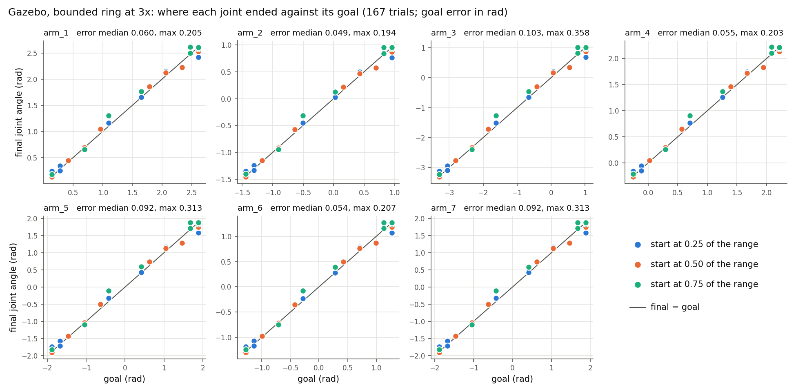

# All seven arm joints across their range (Gazebo)

Date: 2026-10-03, branch `velocity-calibration`. The current default controller:
bounded ring (`bounded-ring.md`) at 3 NEST steps per tick (`speed.md`). Joints
are named `arm_1`..`arm_7`; the scripts' `--joints` take the 0-based index 0-6.

> **Where this stands (2026-10-04).** These are v3 (bounded ring, 3x). The same starts and goals
> were run again with v4 next to v3: [`../results.md`](../../results.md), section "Three start poses".
> One caution for the numbers below: the robot's mobile base was not yet put back before every
> trial, so trials in which the arm pushed on the table also moved the base for the trials after them.

**What was run.** Every joint started from three poses (0.25, 0.5 and 0.75 of
its range, reached with one smooth trajectory after the reset motion) and was
sent to up to 8 goals on both sides of each start, between 0.05 and 0.95 of the
range. Earlier Gazebo runs started from the reset pose only.

```bash
python3 -B scripts/validate_velocity.py --engines full --joints 0 1 2 3 4 5 6 --systems B --starts 0.25 0.5 0.75 --trials 8 --screen-moveit --out /tmp/all
```

167 trials (MoveIt rejected one goal: arm_4 from 0.25 to 0.95 of its range),
48 minutes.

## Result

| | All joints, 167 trials |
| --- | --- |
| Trials that settled | 167 of 167 |
| Wrong-direction / no-drive / clamped trials | 0 / 0 / 0 |
| Goal error median / p90 / max | 0.062 / 0.190 / 0.358 rad |
| Time to 90% of the move, median | 1.95 s |
| Joint travel vs bump travel, median / p90 | 5.9% / 10.0% |
| Ring's joint estimate vs the joint at the end, median / p90 | 0.033 / 0.117 rad |
| Joint moved / commanded | 0.95-1.05 in every trial (nothing blocked the arm) |

| Joint | Range (rad) | Trials | Goal error median / p90 / max (rad) | Ring - joint at end, median / p90 (rad) | Overshoot p90 / max (rad) | Peak speed (rad/s) |
| --- | --- | ---: | --- | --- | --- | ---: |
| arm_1 | 0.00 .. 2.75 | 24 | 0.060 / 0.131 / 0.205 | 0.029 / 0.084 | 0.082 / 0.176 | 1.00 |
| arm_2 | -1.57 .. 1.09 | 24 | 0.049 / 0.125 / 0.194 | 0.028 / 0.090 | 0.076 / 0.163 | 0.98 |
| arm_3 | -3.53 .. 1.26 | 24 | 0.103 / 0.225 / 0.358 | 0.050 / 0.146 | 0.142 / 0.308 | 2.91 |
| arm_4 | -0.39 .. 2.36 | 23 | 0.055 / 0.115 / 0.203 | 0.027 / 0.085 | 0.081 / 0.173 | 0.92 |
| arm_5 | -2.09 .. 2.09 | 24 | 0.092 / 0.200 / 0.313 | 0.045 / 0.129 | 0.125 / 0.268 | 1.54 |
| arm_6 | -1.42 .. 1.42 | 24 | 0.054 / 0.135 / 0.207 | 0.027 / 0.095 | 0.081 / 0.173 | 1.04 |
| arm_7 | -2.10 .. 2.10 | 24 | 0.092 / 0.200 / 0.313 | 0.045 / 0.129 | 0.125 / 0.268 | 1.52 |



How to read it:

- Every joint reaches the neighbourhood of every goal from every start. The
  error in ring indices is the same for all joints (one network); in radians it
  grows with the joint's range, so arm_3, arm_5 and arm_7 are the largest.
- The points furthest from the line are the same on every joint: a move from
  0.75 down to 0.4 of the range stops short (arm_3: goal -1.62, ended at -1.26,
  the largest error at 0.358 rad), a move from 0.25 up to 0.95 stops short
  (arm_3: 0.342 rad), and a short move from 0.75 to 0.9 runs past the goal
  (arm_3: 0.236 rad). These are the comparator's uneven ramp and its weak drive
  on some stretches of the arc (`bounded-ring.md` section 9).
- arm_3's peak of 2.91 rad/s is the joint's measured speed over a single tick,
  above the URDF limit of 2.35 rad/s. The command was
  never clipped in this run (no clamp ticks), so the joint briefly moved faster
  than commanded while catching up. Worth a lower clip before the real arm
  (`speed.md` section 8).
- From spread-out starts the results are better than from the reset pose
  (`speed.md` section 4.3: median 0.093 rad, 2 clamped trials), where arm_1
  and arm_5 start near one end of their range (0.08 and 0.12) and most moves are long.

## Videos

One move per joint from the reset pose to the farthest goal MoveIt accepts.
All seven in one file: [all_joints_3x.mp4](media/all-joints/all_joints_3x.mp4) (52 s).

| Joint | Start -> goal (rad) | Final (rad) | Goal error (rad) | Ticks (s) | Video |
| --- | --- | ---: | ---: | --- | --- |
| arm_1 | 0.210 -> 2.612 | 2.466 | 0.146 | 101 (5.1) | [video](media/all-joints/all_joints_arm1_goal+2.61.mp4) |
| arm_2 | -0.207 -> -1.438 | -1.422 | 0.017 | 124 (6.2) | [video](media/all-joints/all_joints_arm2_goal-1.44.mp4) |
| arm_3 | -2.198 -> -0.657 | -0.494 | 0.163 | 61 (3.1) | [video](media/all-joints/all_joints_arm3_goal-0.66.mp4) |
| arm_4 | 1.149 -> -0.255 | -0.393 | 0.138 | 139 (7.0) | [video](media/all-joints/all_joints_arm4_goal-0.26.mp4) |
| arm_5 | -1.571 -> 1.885 | 1.631 | 0.254 | 92 (4.6) | [video](media/all-joints/all_joints_arm5_goal+1.88.mp4) |
| arm_6 | 0.198 -> -1.276 | -1.320 | 0.045 | 123 (6.2) | [video](media/all-joints/all_joints_arm6_goal-1.28.mp4) |
| arm_7 | -0.001 -> 1.886 | 1.757 | 0.130 | 57 (2.9) | [video](media/all-joints/all_joints_arm7_goal+1.89.mp4) |

These are the longest moves, so their errors are above the medians in the table
above. arm_4's video is the trial where the joint runs past the goal to its
lower limit and is held there.

## Notes

- MoveIt's check covers the robot's own body. Whether its scene includes the
  table was not verified; in this run no trial showed a blocked joint.
- `validate_velocity.py --screen-moveit` now also checks the move from the reset
  pose to each start pose and leaves a start out if it would collide.
- Data: `media/all-joints/data/gazebo_all_joints_3x.json` (every trial);
  `make_figure.py` draws the figure, `scripts/speed_report.py` the table.
