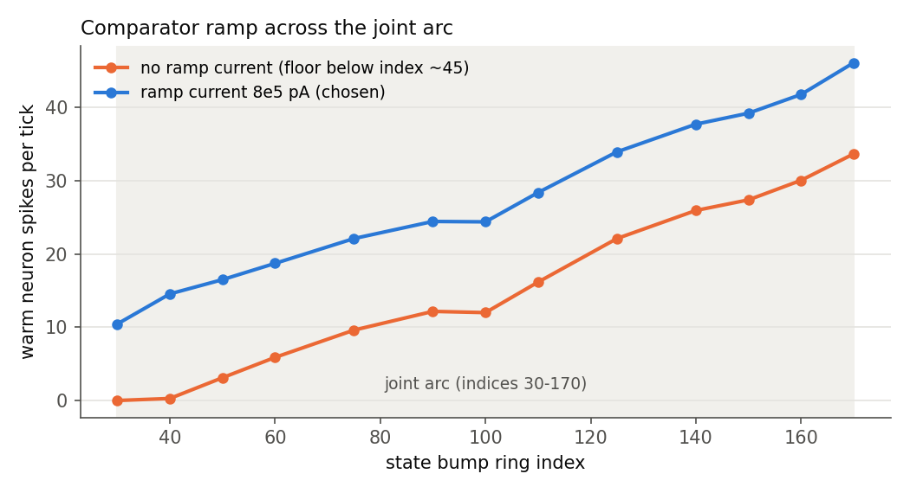
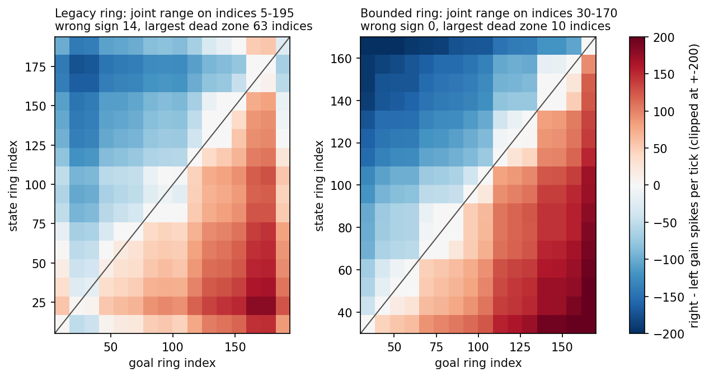
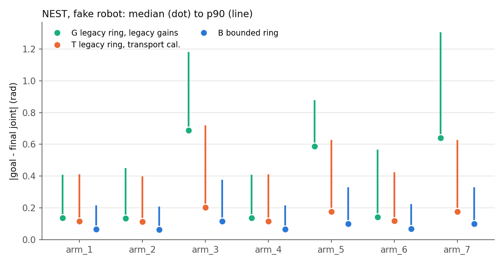
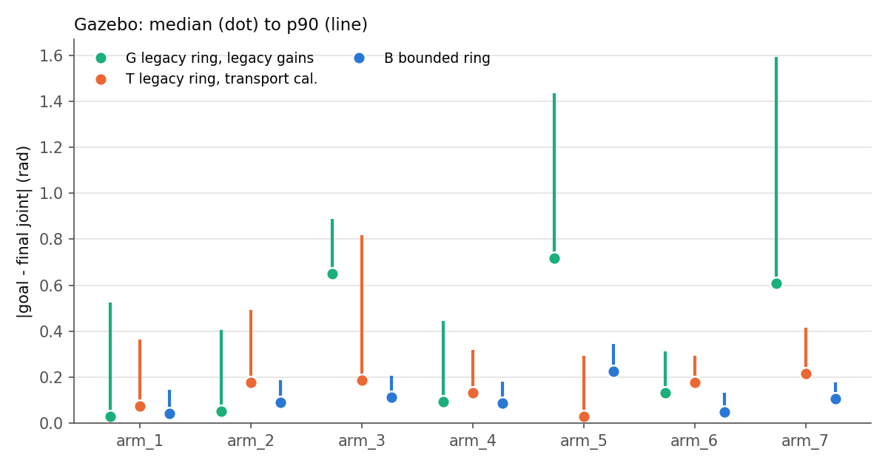
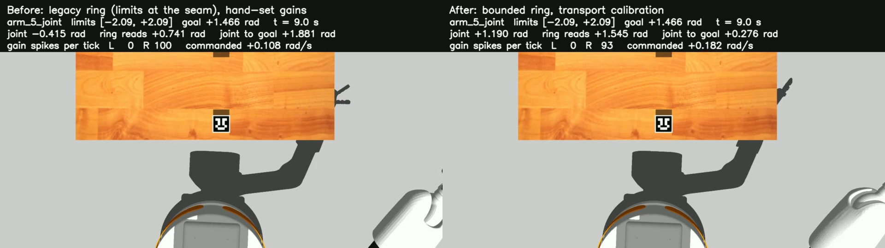

# Bounded ring: reading the joint from the ring, limits, recalibration, every joint

Date: 2026-10-03, branch `velocity-calibration`. Joints are named `arm_1`..`arm_7`; the scripts' `--joints` take the 0-based index (arm_6 is 5). Follows `calibration.md`
(transport calibration). The runs below are at one NEST step per robot tick; the template now defaults to three, which
makes the joints 2.8 times faster (`speed.md`). Idea taken from Ferrari et al., *bounded ring
attractor* (arXiv 2604.14021): put the joint range on an arc of the ring, make
the rest of the ring a place where no bump can rest, fade the motion drive at
the limits, and read the angle with a population vector. Real NEST
`HEAD@41892a5`; Gazebo 11 headless from the pinned image.

> **Where this stands (2026-10-04).** The bounded ring is the ring of both current versions: v3
> (`two_ring_single_joint --bounds bounded`) and v4 (`three_ring_single_joint`). What this report
> found still holds: no wrong-direction, no-drive or clamped trials, and a joint angle that can be
> read off the ring. The goal error it left (median 0.06-0.09 rad) is what v4's body feedback
> removes. The comparison of every system on the same goals is [`../results.md`](../../results.md);
> the comparison with the legacy scripts in section 9 below is superseded by it.

## 1. Was it the way the ring's minimum and maximum are set?

Partly, yes. Everything near a joint limit came from where the limits sit on the
ring. The bump stopping short **inside** the range came from the comparator
target being a sawtooth that jumps at the ring seam. Measured on the legacy
ring (joint range on indices 5-195), real NEST, bump transport frozen:

| Finding | Evidence | From the min/max placement? |
| --- | --- | --- |
| The comparator was fitted to a 0-to-1 sawtooth over the whole ring, so its ramp jumps at index 0/200. The joint limits sat at indices 5 and 195, right beside that jump. | Comparator output by state index: 5: 13.1, **15: 1.5**, 25: 10.4 ... 165: 30.8, **175: 28.1**, 185: 35.6, **195: 22.9** (should rise steadily) | yes |
| Goals near a limit are misread. A goal at the maximum reads as low, so every state above index ~135 is driven **down**. | Decision map: 14 wrong-sign cells, dead zones up to 63 indices (figure below, left) | yes |
| A bump at a limit is reported 60 indices off: the readout used a linear centroid, which breaks for a bump straddling the seam. | Injected at 5, reported 65; at 194, reported 136. The circular centroid is within 0.5. | yes |
| A bump at the upper end overshoots to about 190 and sticks, or crosses the seam (joint commanded to 2.41 rad, limit 1.417). | `calibration.md` section 7 | yes |
| Inside the range the fitted ramp wobbles (20 sine harmonics fitting a jump): 20 of 59 two-index steps between 40 and 160 go the wrong way, leaving dead zones of 10-20 indices. | Held-out fit on 100 readout positions | indirectly |
| A second cause, found during this work: the comparator's warm/cold neurons stop firing over the lower part of the range (rate floor at 0), so goals in the bottom ~15% of the range cannot be told apart. Down moves were driven at about half the rate of up moves. | Section 3.3 | no (comparator operating point) |

## 2. What changed

```text
            seam (index 0/200)
        wall: bias current x0.9, no bump rests here
  index 15 |----------- joint arc, indices 30 .. 170 -----------| index 185
           |  joint_min = index 30      joint_max = index 170   |
           | gain drive to the left cut   gain drive to the right cut beyond 170
```

| Part | Legacy ring | Bounded ring (`two_ring_single_joint(bounds="bounded")`) |
| --- | --- | --- |
| Mapping | joint range on indices 5-195; limits at the seam | `ArcMapping`: range on 70% of the ring (indices 30-170), centred on index 100 opposite the seam (`control/mapping.py`) |
| Ring | uniform bias current | wall: neurons outside indices 15-185 at 0.9 x `I_e` (`Ring.wall`, `outside_current_scale`) |
| Gain | ring -> gain drive everywhere except 5 neurons at each end | the population that moves the bump **toward** a limit gets no drive from neurons at or past that limit (`Gain.limit_arc`, `limit_taper=0`); moving back is never blocked |
| Comparator | weights fitted to the sawtooth | weights fitted to a continuous ramp that rises across 80% of the ring and falls across the seam sector (`training/comparator.py`, `scripts/fit_comparator.py`, artifact `N_200_bounded_a070`); warm and cold neurons get +8e5 pA bias (`Homeostasis.ramp_current`) so the ramp stays above the rate floor across the whole arc |
| Reading the joint from the ring | linear centroid (wrong at the seam) | `RingState` block: circular population-vector average of the state ring -> index -> joint angle (clamped to the limits), plus `strength` and `in_arc`. The ring datapack, the corrective encoder and the dashboard use the circular centroid too. |
| Decoder | transport calibration of the legacy ring | its own transport calibration (`transport_calibration_bounded.json`); the settle check reads the raw filtered count, so a trial does not end while the bump still creeps under the dead zone |
| Start pose | reset motion only | `set_start_pose({joint: rad})` on the fake robot and in Gazebo (one smooth trajectory after the reset motion) |

The legacy graph is unchanged and still pinned by the parity tests and the old
artifacts. Bounded-ring parameters left at their off values are not part of
the network fingerprint, so `transport_calibration.json` still matches it.

## 3. Choosing the bounded network (real NEST, fake robot)

### 3.1 Arc and comparator target

Decision maps (comparator drive for 16 x 16 state/goal pairs, transport frozen),
and moving trials of arm_6 (joint index 5; 72 trials, 3 seeds):

| Network | Wrong-sign cells | Largest dead zone | Goal error median / p90 / max (rad) | Wrong-direction trials |
| --- | ---: | ---: | --- | ---: |
| legacy ring | 14 | 63 | 0.122 / 0.342 / 2.733 | 2 |
| arc 60% | 0 | 8 | 0.095 / 0.287 / 0.611 | 0 |
| **arc 70%** | **0** | **9** | **0.081 / 0.239 / 0.320** | **0** |
| arc 75% | 1 | 20 | not run | |

The comparator target rises across 80% of the ring (5 points beyond each arc
end, so the ramp is still rising at the limits). Re-injecting the goal (50 Hz
or 25 Hz) made errors worse (median 0.29-0.30 rad); a corrective goal
(re-inject when it drifts by 2 or 4 indices) changed nothing (median
0.080-0.096). The goal is injected once, as before.

Comparator gain (`weight_scale`), 36 moving trials each: 5e6 median 0.097 /
max 0.302 rad; 7.5e6 0.114 / 0.603; 1e7 0.123 / 0.603; 1.5e7 0.120 / 0.882.
A higher gain makes the decision pair overshoot; 5e6 stays.

### 3.2 Limits: the taper

The paper fades the motion drive smoothly near a limit. Here a 10-index fade
left the bump creeping through the fade zone at gain rates below the decoder's
dead zone (18 spikes per tick): the bump reached the limit and the joint stopped
0.2-0.3 rad short of it. A hard cut at the arc end (`limit_taper=0`) keeps the
gain rate high until the bump arrives. In 8 limit and interior trials the
largest goal error went from 0.358 to 0.211 rad.

### 3.3 The comparator's rate floor

With the bounded weights the warm (state) and cold (goal) neurons fire 0-0.3
spikes per tick over indices 30-40 and only 3-6 up to index 60. Their
difference, which is the decision, therefore vanishes there. Adding the same bias current to
both neurons keeps the difference (warm still equals cold when state equals
goal) and lifts the whole ramp off the floor:



36 moving trials, arm_6, 4 start poses x 10 goals across the whole range:

| Setting | Goal error median / p90 / max (rad) | Stops short, up / down (median, rad) | Ring - joint at end (median / p90) | Trials ending at the step limit |
| --- | --- | --- | --- | ---: |
| arc 70%, taper 10, no ramp current | 0.137 / 0.293 / 0.415 | +0.017 / +0.146 | 0.054 / 0.191 | 9 |
| + taper 0, ramp current 4e5 | 0.093 / 0.280 / 0.318 | -0.011 / +0.092 | 0.041 / 0.121 | 3 |
| **+ taper 0, ramp current 8e5 (chosen)** | **0.069 / 0.202 / 0.300** | **+0.029 / +0.042** | **0.021 / 0.146** | **0** |
| + taper 0, ramp current 1.2e6 | 0.082 / 0.193 / 0.300 | +0.023 / +0.064 | 0.054 / 0.145 | 0 |
| + taper 0, ramp current 8e5, gain 7.5e6 | 0.063 / 0.255 / 0.617 | -0.051 / +0.057 | 0.044 / 0.120 | 0 |

Final decision map: no wrong-sign cell, largest dead zone 10 indices; one pair
more than 10 indices apart gives no drive.



The bounded map's corner cells (state near one limit, goal at the other) reach
about +-600 spikes per tick; the colour scale is clipped at +-200.

### 3.4 Transport calibration of the bounded network

`scripts/calibrate_transport.py --bounds bounded --starts 45 70 95 120 145
--goals 45 70 95 120 145 155`: 96 trials, 94 usable (2 moved less than 5
indices). The dead-zone model wins again:

| Network | a (indices per spike) | theta (spikes per tick) | held-out median | p90 | bias left / right |
| --- | ---: | ---: | ---: | ---: | --- |
| legacy ring (`transport_calibration.json`) | 0.005332 | 20 | 4.8% | 13.0% | -0.6% / -0.5% |
| bounded ring (`transport_calibration_bounded.json`) | 0.005266 | 18 | 5.1% | 12.4% | +1.5% / -0.8% |

The arc is 140 indices instead of 190, so a ring index stands for 36% more
radians; with the slightly smaller `a` the decoder gains are 34% larger (arm_6:
0.002132 against 0.001591 rad/s per spike per tick).

## 4. Every joint on NEST (fake robot)

`scripts/validate_velocity.py --engines nest --joints 0 1 2 3 4 5 6 --systems G T B
--starts 0.25 0.5 0.75 --seeds 13579 7 99 --trials 8`: per joint and system 72
trials (3 start poses x 3 seeds x 8 goals). Goals and starts are fractions of
each joint's range, so all three systems get the same radians. Goals lie
0.05-0.95 of the range and at least 0.15 of it from the start.

| System | Trials | Goal error median / p90 / max (rad) | Tracking median / p90 | Ring - joint at the end, median / p95 (rad) | No drive | Wrong way | Clamped trials |
| --- | ---: | --- | --- | --- | ---: | ---: | ---: |
| G legacy ring, legacy gains | 504 | 0.329 / 0.838 / 2.045 | 16.6% / 42.9% | 0.084 / 2.710 | 111 | 15 | 27 |
| T legacy ring, transport calibration | 504 | 0.137 / 0.547 / 0.959 | 3.8% / 10.5% | 0.032 / 2.725 | 57 | 17 | 42 |
| **B bounded ring** | 504 | **0.080 / 0.326 / 0.719** | 4.2% / 13.8% | **0.032 / 0.171** | **42** | **0** | **0** |

Per joint (goal error median / p90 in rad, then tracking median, wrong-way trials):

| Joint | G | T | B |
| --- | --- | --- | --- |
| arm_1 | 0.137 / 0.408, 8.3%, 2 | 0.116 / 0.412, 3.8%, 2 | **0.066 / 0.216**, 4.2%, 0 |
| arm_2 | 0.133 / 0.451, 5.6%, 4 | 0.112 / 0.399, 3.8%, 3 | **0.064 / 0.209**, 4.2%, 0 |
| arm_3 | 0.687 / 1.181, 41.9%, 3 | 0.202 / 0.719, 3.8%, 3 | **0.116 / 0.377**, 4.2%, 0 |
| arm_4 | 0.137 / 0.408, 7.3%, 2 | 0.116 / 0.412, 3.8%, 2 | **0.066 / 0.216**, 4.2%, 0 |
| arm_5 | 0.589 / 0.879, 33.6%, 2 | 0.176 / 0.628, 3.8%, 2 | **0.101 / 0.329**, 4.2%, 0 |
| arm_6 | 0.142 / 0.567, 7.7%, 2 | 0.119 / 0.425, 3.8%, 3 | **0.068 / 0.223**, 4.2%, 0 |
| arm_7 | 0.642 / 1.307, 33.5%, 0 | 0.176 / 0.629, 3.8%, 2 | **0.101 / 0.329**, 4.2%, 0 |



Full per-joint table (bias, settle time, wall time): `media/bounded/tables.md`. All raw results (every trial) are in `media/bounded/data/`; `scripts/bounded_ring_report.py` rebuilds the tables and figures from them.

How to read it:

- With the fake robot every joint runs the same network; only the radians per
  ring index differ. So T and B give the same tracking on every joint, and the
  goal error in radians scales with the joint's range: arm_3, arm_5 and arm_7
  have the widest ranges. In ring indices B's goal error is median 3.4, p90 11.1.
  The legacy gains (G) were hand-set per joint, and the wide joints (arm_3, arm_5,
  arm_7) are 30-40% off in tracking.
- B is the only system with **no wrong-direction trial and no clamp event**. All
  of G's and T's wrong-way trials have goals at 0.1 or 0.9 of the range (the
  sawtooth seam misreads them), and all their clamp events are goals at 0.95 or
  0.05 (the bump overshoots past the limit).
- The ring's joint estimate (`RingState`) matches the joint to a median 0.032
  rad at the end of a B trial and 0.022-0.038 rad during it. The p95 (0.171 rad)
  comes from goals next to a limit (85 trials over 0.1 rad, 39 of them with goals at 0.05 or
  0.95 of the range): there the bump sits a few indices past the arc end. This
  run predates clamping the readout to the joint limits, so these values are an
  upper bound. With the legacy ring the p95 is 2.7 rad: a bump past index 195
  wraps to the other end of the range.
- All of B's 42 no-drive trials are the shortest moves (0.15 of the range, 21
  ring indices, from starts at 0.25/0.75 toward the middle). The comparator
  drives there, but below the decoder's dead zone of 18 spikes per tick.
- B settles in 7.5 simulated seconds on average against 12 s for G and T. B
  never hits the 400-step limit; G does in 150 trials and T in 133.

## 5. Every joint in Gazebo

### 5.1 The robot (stage C, no NEST)

`scripts/identify_actuator.py --joints 0 1 2 3 4 5 6`: velocity steps of +-0.02,
+-0.1 and +-0.4 rad/s streamed lock-step through `CommandState` and
`arm_controller`.

| Joint | arm_1 | arm_2 | arm_3 | arm_4 | arm_5 | arm_6 | arm_7 |
| --- | ---: | ---: | ---: | ---: | ---: | ---: | ---: |
| displacement gain (joint / command) | 0.992 | 0.991 | 0.992 | 0.992 | 0.997 | 0.985 | 0.989 |
| lag (ms) | 13 | 7 | 5 | 6 | 12 | 14 | 8 |
| largest \|q - q_cmd\| (rad) | 0.016 | 0.013 | 0.008 | 0.007 | 0.011 | 0.011 | 0.006 |

All 7 joints are within 0.97-1.03, so no actuator correction is applied. A tick
takes 51 ms of wall time (the simulation runs at real time).

### 5.2 The full loop

`scripts/validate_velocity.py --engines full --joints 0 1 2 3 4 5 6 --systems G T B
--trials 8 --screen-moveit`: from the reset pose, 8 goals per joint on both sides
of it where the range allows. MoveIt (`/check_state_validity`, 10 points along
each single-joint path) rejected 2 goals (arm_4 at 0.9 and 0.95 of its range),
so 54 trials per system.

| System | Trials | Goal error median / p90 / max (rad) | Tracking median / p90 | Ring - joint at the end, median / p95 (rad) | No drive | Wrong way | Clamped trials |
| --- | ---: | --- | --- | --- | ---: | ---: | ---: |
| G legacy ring, legacy gains | 54 | 0.329 / 1.049 / 1.886 | 14.2% / 39.7% | 0.110 / 1.973 | 6 | 0 | 1 |
| T legacy ring, transport calibration | 54 | 0.138 / 0.431 / 0.821 | 3.4% / 8.9% | 0.038 / 0.641 | 1 | 0 | 2 |
| **B bounded ring** | 54 | **0.090 / 0.232 / 0.358** | 5.4% / 11.6% | 0.044 / 0.193 | **0** | **0** | **0** |

Per joint, goal error median / p90 (rad) and tracking median / p90:

| Joint | G | T | B |
| --- | --- | --- | --- |
| arm_1 | 0.029 / 0.525, 8.5% / 36.2% | 0.074 / 0.364, 2.4% / 4.2% | 0.042 / 0.143, 7.8% / 10.8% |
| arm_2 | 0.052 / 0.406, 8.1% / 26.8% | 0.176 / 0.491, 3.7% / 5.3% | 0.091 / 0.187, 3.6% / 8.5% |
| arm_3 | 0.649 / 0.889, 32.9% / 45.4% | 0.186 / 0.816, 2.4% / 3.1% | 0.111 / 0.205, 3.7% / 6.9% |
| arm_4 | 0.095 / 0.443, 4.7% / 18.9% | 0.131 / 0.318, 3.4% / 9.7% | 0.085 / 0.180, 5.0% / 18.5% |
| arm_5 | 0.716 / 1.436, 36.8% / 40.3% | 0.028 / 0.292, 1.5% / 5.9% | 0.226 / 0.343, 5.2% / 10.3% |
| arm_6 | 0.132 / 0.311, 6.5% / 12.9% | 0.177 / 0.291, 3.4% / 21.1% | 0.048 / 0.132, 6.9% / 11.6% |
| arm_7 | 0.609 / 1.593, 19.3% / 26.8% | 0.214 / 0.415, 8.1% / 12.0% | 0.105 / 0.178, 3.1% / 11.2% |



- B finishes every trial on every joint: no clamp (T clamped on arm_3 and arm_6
  for 122 and 114 ticks; G on arm_6 for 73), no wrong-direction and no no-drive
  trial, all 54 trials usable for tracking (G 37, T 42).
- B has the lowest maximum goal error on all 7 joints, the lowest p90 on 6 (not
  arm_5) and the lowest median on 4 (arm_3, arm_4, arm_6, arm_7). On arm_1 and
  arm_2 G's median is lower, but its p90 is 3-4 times B's.
- arm_5 is B's worst joint (median 0.226 rad, where T reaches 0.028). arm_5
  starts at 0.12 of its range, so all 8 goals are long upward moves. On those
  the bump overshoots its goal by 3-8 ring indices, and arm_5 has the widest
  index (0.030 rad). The joint follows the bump (joint/bump 0.91-1.13); the
  overshoot comes from the network.
- The robot does what it is told: B's joint / commanded displacement is
  0.993-1.016 over all its trials. G and T drop to 0.70 and 0.55 in the trials
  where the limit clamp holds the joint while the decoder still commands motion.
- B's bump never left the arc (plus the 5-index readout margin) in any NEST or
  Gazebo trial.
- Tracking: B meets 6% median / 15% p90 / +-3% bias on arm_2, arm_3, arm_5 and
  arm_7. It misses the median on arm_1 (7.8%) and arm_6 (6.9%), and the p90 on
  arm_4 (18.5%). Over all joints it is 5.4% / 11.6%, slightly behind T (3.4% /
  8.9%). With 8 trials per joint one trial moves the p90.

## 6. Against the legacy system

Four systems on the same joints and goals in the same Gazebo session:

| System | What it is |
| --- | --- |
| **L** legacy | The frozen original scripts: `legacy/single_joint_data_collector.py` (`SingleRingModel` built synapse by synapse, a `rospy.sleep` loop that is not lock-stepped, hand gains from `velocity_calibration.json`), driven unchanged by `scripts/run_legacy_trials.py` |
| **G** | Graph runtime, legacy ring, the same hand gains |
| **T** | Graph runtime, legacy ring, transport calibration |
| **B** | Graph runtime, bounded ring |

Joints arm_2, arm_5, arm_6 and arm_7 (the four joints the plan named), the 8
goals `validate_velocity.py` plans from the reset pose (L gets them via
`--plan 8`), so 32 trials per system.

### 6.1 Accuracy

| Joint | System | Goal error median / p90 / max (rad) | Tracking median | Ring - joint during the trial (median, rad) | No drive | Wrong way | Trials ending at the step limit |
| --- | --- | --- | ---: | ---: | ---: | ---: | ---: |
| arm_2 | L | 0.139 / 0.310 / 0.427 | 11.0% | 0.036 | 1 | 0 | 4 |
| | G | 0.052 / 0.406 / 0.427 | 8.1% | 0.047 | 1 | 0 | |
| | T | 0.176 / 0.491 / 0.639 | 3.7% | 0.014 | 1 | 0 | |
| | **B** | 0.091 / **0.187 / 0.209** | **3.6%** | 0.020 | **0** | 0 | 0 |
| arm_5 | L | 0.703 / 1.079 / 1.209 | 40.0% | 0.606 | 0 | 0 | 4 |
| | G | 0.716 / 1.436 / 1.816 | 36.8% | 0.634 | 0 | 0 | |
| | T | **0.028** / 0.292 / 0.363 | 1.5% | 0.052 | 0 | 0 | |
| | B | 0.226 / 0.343 / 0.358 | 5.2% | 0.051 | 0 | 0 | 0 |
| arm_6 | L | 0.156 / 0.384 / 0.429 | 7.3% | 0.082 | 0 | 0 | 3 |
| | G | 0.132 / 0.311 / 0.454 | 6.5% | 0.045 | 1 | 0 | |
| | T | 0.177 / 0.291 / 0.433 | 3.4% | 0.019 | 0 | 0 | |
| | **B** | **0.048 / 0.132 / 0.241** | 6.9% | 0.024 | 0 | 0 | 0 |
| arm_7 | L | 0.421 / 0.711 / 0.834 | 30.7% | 0.329 | 1 | 0 | 5 |
| | G | 0.609 / 1.593 / 1.886 | 19.3% | 0.039 | 4 | 0 | |
| | T | 0.214 / 0.415 / 0.565 | 8.1% | 0.060 | 0 | 0 | |
| | **B** | **0.105 / 0.178 / 0.190** | **3.1%** | 0.043 | 0 | 0 | 0 |

- **B against L**: B's goal error is lower than the legacy scripts' on all four
  joints, in median, p90 and max (median 0.091 / 0.226 / 0.048 / 0.105 rad
  against 0.139 / 0.703 / 0.156 / 0.421). B tracks the bump better on all four
  (median 3.1-6.9% against 7.3-40%). L ends 16 of its 32 trials at the 400-step
  limit, B none.
- G reproduces L closely (same ring, same gains, now lock-stepped): on arm_5 and
  arm_6 their median goal errors differ by 0.013 and 0.024 rad. The difference
  between L and B is the model, not the runtime.
- L's tracking and ring estimate use its recorded linear centroid. That
  centroid is wrong when the bump is near the seam, so L's p90 tracking values
  (60-200%) are not meaningful and are left out.
- arm_5: T beats B (section 5.2: long upward moves, the bump overshoots).

### 6.2 Repeatability

3 runs of each of 2 goals per joint, all four systems. Spread of the final joint
angle over the 3 runs:

| Joint, goal | L | G | T | B |
| --- | ---: | ---: | ---: | ---: |
| arm_2, -1.438 / +0.292 | 0.000 / 0.000 | 0.000 / 0.000 | 0.000 / 0.000 | 0.000 / 0.000 |
| arm_5, -0.838 / +1.885 | 0.000 / 0.001 | 0.000 / 0.000 | 0.000 / 0.000 | 0.000 / 0.000 |
| arm_6, -1.276 / +0.709 | 0.001 / 0.000 | 0.000 / 0.000 | 0.000 / 0.000 | 0.000 / 0.000 |
| arm_7, -1.886 / +0.629 | 0.000 / 0.000 | 0.000 / 0.000 | 0.000 / 0.000 | 0.000 / 0.000 |

All systems repeat to 1 mrad. With `/use_sim_time` the legacy `rospy.sleep`
waits for simulated time, and NEST is seeded, so the legacy loop is
deterministic here even though it is not lock-stepped. Repeatability does not
separate the systems; accuracy does.

### 6.3 Timing

| | L legacy scripts | G / T / B graph runtime |
| --- | --- | --- |
| Loop | `rospy.sleep(50 ms)` in simulated time, then NEST | lock-stepped: Gazebo is stepped 50 ms, then NEST |
| Wall time per 50 ms tick | 54 ms (separate measurement: 50.6 ms mean, 82.9 ms max) | 58 ms (all three) |
| Drift of simulated time against NEST time | 115 ms over 200 ticks (1.2%) | 0 by construction |
| Network build per trial | 8.7 s (synapse by synapse) | about 0.1 s (vectorised) |
| Reset motion per trial | 9.1 s | 9.3 s |
| Simulated time per trial | 15.4 s (L), many at the step limit | G 14.0 s, T 13.5 s, **B 10.0 s** |
| Wall time per trial | **33.3 s** | G 25.7 s, T 25.0 s, **B 21.0 s** |

The graph runtime ticks 4 ms slower than the legacy loop (it waits for Gazebo
to finish each step instead of sleeping), but it builds the network almost
instantly and B's trials end sooner, so B takes 37% less wall time per trial
than the legacy scripts.

## 7. Videos (Gazebo, camera `/recording_camera`)

Side by side: left G (legacy ring, hand-set gains), right B (bounded ring); same
joint, start pose and goal. The overlay shows the measured joint, the angle
`RingState` reads off the ring, the gain spikes and the command.

| Joint, goal | G: final / goal error | B: final / goal error | B: ring reads | Video |
| --- | --- | --- | --- | --- |
| arm_6, -1.276 rad (near the lower limit) | -1.104 / 0.172 short | -1.294 / 0.019 past | -1.172 | [before/after](media/bounded/bounded_joint5_goal-1.28_before_after.mp4) |
| arm_6, +1.134 rad (0.9 of the range) | +0.885 / 0.248 short | +1.218 / 0.085 past | +1.281 | [before/after](media/bounded/bounded_joint5_goal+1.13_before_after.mp4) |
| arm_5, +1.466 rad (from -1.571) | +0.196 / 1.270 short, 400 steps | +1.416 / 0.050 short | +1.731 | [before/after](media/bounded/bounded_joint4_goal+1.47_before_after.mp4) |
| arm_2, -1.172 rad (0.15 of the range) | -1.189 / 0.017 past, 400 steps | -0.964 / 0.208 short | -1.007 | [before/after](media/bounded/bounded_joint1_goal-1.17_before_after.mp4) |

Single runs are in the same folder (`..._G.mp4`, `..._B.mp4`), with numbers in
`bounded_videos.json`. The last row is a case where B does worse: the bump
stops 0.2 rad short of a goal near the lower limit. G gets there only because
its hand gain is too small for the bump's travel and the 400-step limit happens to
end the trial near the goal. On arm_5, B's ring reads 0.31 rad beyond where the
joint stopped: the bump overshot the goal (section 5.2).



## 8. Acceptance criteria

Written before the runs (plan, 2026-10-03).

| Criterion | Target | Result | |
| --- | --- | --- | --- |
| Wrong-sign decisions in the arc, \|state - goal\| >= 10 | 0 | 0 (legacy ring: 14) | met |
| Dead zone, median half-width | <= 10 indices | median 0, max 10 (legacy: max 63) | met |
| Bump outside the arc, seam crossings, limit clamps | 0 | 0 in 504 NEST and 54 Gazebo trials | met |
| Ring joint estimate vs measured joint, median / p95 | <= 0.03 / 0.08 rad | NEST 0.032 / 0.171; Gazebo 0.044 / 0.193. Away from the limits 0.02-0.04 median; the p95 comes from goals at a limit | **not met** |
| Tracking per joint, median / p90 / bias | <= 6% / 15% / +-3% | NEST 4.2% / 13.1% / -1.0%, +2.1% on every joint; Gazebo met on 4 of 7 joints (5.4% / 11.6% overall) | partly met |
| Goal error per joint, median | lower than today (T) on every joint | NEST: all 7. Gazebo: 6 of 7 (arm_5 0.226 against 0.028) | partly met |
| No-drive trials, goals >= 15 indices away | <= 10% | NEST 42 / 504 (8.3%), Gazebo 0 / 54 | met |
| Robot: joint / command | 0.97-1.03 on all 7 joints | 0.985-0.997 (stage C); 0.993-1.016 in B's trials | met |
| B against the legacy scripts L, same goals | goal error and tracking no worse on any joint tested | lower goal error (median, p90, max) and tracking on all 4 joints tested (arm_2, arm_5, arm_6, arm_7) | met |

## 9. What did not work, and what is left

- **The paper's smooth fade at the limits** (`limit_taper` 10): the bump crept
  through the fade zone below the decoder dead zone, so the joint stopped
  0.2-0.3 rad before the limit. A hard cut works better here.
- **Re-injecting the goal** (50 Hz, 25 Hz) or correcting it when it drifts: no
  better, or worse (section 3.1).
- **Higher comparator gain**: larger overshoot (section 3.1).
- **Long fast moves overshoot** by 3-8 ring indices. With the ramp current, the
  comparator drives far moves hard (up to ~600 spikes per tick from one end of
  the arc to the other), and the bump carries on past the goal before the
  decision flips. This is now the largest error on wide joints. A next step
  would be to saturate the comparator output or to scale the gain population's
  drive with distance.
- **Short moves (about 20 indices) give no drive**: the comparator drives, but
  below the decoder's dead zone of 18 spikes per tick.
- **At a limit, ring and joint differ by up to 0.15 rad**: the bump settles a few
  indices past the arc end while the joint stops a little short of it.
  `RingState` clamps its angle to the joint limits; the validation runs above
  were made before that clamp, so their p95 values are upper bounds.
- **The joint is not read from the robot back into the ring.** `RingState` reads
  what the ring holds. Driving a ring from the measured joint velocity (the
  paper's path integration) is a separate piece of work.
- Not done: limits from the URDF (`limits_source="urdf"`); the runs use the
  measured limits in `velocity_calibration.json`, which are within the URDF
  limits. `multi_joint_two_ring` still uses the legacy ring.

## 10. Rerunning

```bash
# inside the container, package root
python3 -B scripts/fit_comparator.py collect --out /tmp/cmp
python3 -B scripts/fit_comparator.py fit --library /tmp/cmp --rise-fraction 0.8 --arc-fraction 0.7 --name N_200_bounded_a070 --out /tmp/cmp
python3 -B scripts/fit_comparator.py map --bounds bounded --out /tmp/cmp/map_bounded
python3 -B scripts/calibrate_transport.py --bounds bounded --starts 45 70 95 120 145 --goals 45 70 95 120 145 155 --out /tmp/cal_bounded
python3 -B scripts/validate_velocity.py --engines nest --joints 0 1 2 3 4 5 6 --systems G T B --starts 0.25 0.5 0.75 --seeds 13579 7 99 --trials 8 --time-scale 1 --out /tmp/val_nest
# with the simulation running
python3 -B scripts/identify_actuator.py --joints 0 1 2 3 4 5 6
python3 -B scripts/validate_velocity.py --engines full --joints 0 1 2 3 4 5 6 --systems G T B --trials 8 --screen-moveit --time-scale 1 --out /tmp/val
python3 -B scripts/run_legacy_trials.py --joint 5 --plan 8 --out /tmp/legacy
python3 -B scripts/measure_legacy_tick.py --ticks 200
```

`--time-scale 1` reproduces this page (one NEST step per tick); without it system B runs at the template's 3 (`speed.md`).

`--install` on `fit_comparator.py fit` or `calibrate_transport.py --bounds bounded`
changes a scientific input: update `test/golden/` and this page. The
bounded-ring parameters are in `graph/templates.py` (`BOUNDED`); the real-NEST
gate is `test/test_bounded_ring_real_nest.py`.
