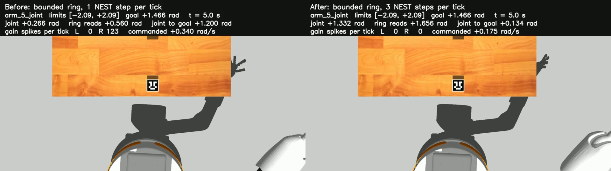

# Faster joints: a speed knob for the bounded ring

Date: 2026-10-03, branch `velocity-calibration`. Follows `bounded-ring.md`.
Joints are named `arm_1`..`arm_7`; the scripts' `--joints` take the 0-based
index (arm_6 is 5). Real NEST `HEAD@41892a5`; Gazebo 11 headless.

> **Where this stands (2026-10-04).** `time_scale` is the speed setting of v3 and of v4 (both
> default to 3). The measurements below are v3; v4 at 1x and 3x is in
> [`../results.md`](../../results.md). How to change the speed: top-level `README.md`, section 4.

**Result.** The bounded template now runs 3 NEST steps per robot tick
(`time_scale=3`). In Gazebo a move reaches 90% of its distance in a median 2.35 s
instead of 6.93 s (2.85 times faster) with the same goal error (median 0.093 rad
against 0.089). The speed is one integer: `time_scale=1` gives the old behaviour,
2 and 4 are measured below.

```bash
python3 -B scripts/run_graph.py --template two_ring_single_joint --bounds bounded --engines nest --goal 1.0                 # 3x, the default
python3 -B scripts/run_graph.py --template two_ring_single_joint --bounds bounded --time-scale 1 --engines nest --goal 1.0  # as before
```

In Python: `two_ring_single_joint(bounds="bounded", time_scale=k)`.

## 1. Why the joints were slow

The joint follows the state bump, so joint speed = bump speed x radians per ring
index. The bump moves about `a x (rate - theta)` indices per 50 ms (`a` = 0.0053
indices per gain spike, `theta` = 18 spikes): 0.19 indices per tick at 50-60
spikes, 0.53 at 110-130. That is at most about 10 indices per second, or
0.2-0.3 rad/s. The comparator's drive falls as the bump nears the goal, so every
move ends in a slow approach. Measured in Gazebo (bounded ring, 54 trials): a
median move of 1.09 rad took 8.9 s; peak joint speed median 0.27 rad/s.

The robot was never the limit. The arm's URDF velocity limits are 1.95, 1.95,
2.35, 2.35, 1.95, 1.76, 1.76 rad/s (arm_1..arm_7), and the graph clipped
commands at 1.0 rad/s.

## 2. Two ways to go faster

**A. More network time per robot tick (`simulation.time_scale` = k).** Each 50 ms
robot tick runs k steps of 50 ms of NEST. The encoders inject before the first
step and the spike counts cover the whole tick. In `once` mode the network never
sees the robot after the injection, so it follows **the same path, spike for
spike**, and the robot follows it k times faster. Checked on real NEST: the
ring's counts per tick at k = 3 equal the sums of three steps of the k = 1 run
in 38 of 38 and 80 of 80 ticks (`test_bounded_ring_real_nest.py`). The cost: the
neurons run k times faster than the robot's clock.

The decoder needs one change. A tick carries k times the spikes, and the bump
moves `a x (R - k theta)` indices per tick. So the gain `a rho / dt` stays, the dead
zone becomes `k theta`, and the settle threshold scales by k
(`graph/templates.py` `decoder_params`). The transport calibration stays valid:
the network is unchanged.

**B. Stronger transport, network time = robot time.** Make the bump move further
per decision: a larger gain-to-ring feedback weight, or more drive into the gain
populations. Each setting is a different network and was recalibrated
(`calibrate_transport.py --bounds bounded --set ...`, 96 trials each):

| Setting | a (indices per spike) | theta | Held-out error of the transport fit, median / p90 |
| --- | ---: | ---: | --- |
| today (feedback -0.6) | 0.0053 | 18 | 5.1% / 12.4% |
| feedback x1.5 (-0.9) | 0.0100 | 26 | 7.5% / 15.3% |
| feedback x2 (-1.2) | 0.0194 | 34 | 10.5% / 23.8% |
| feedback x3 (-1.8) | 0.0505 | 40 | 11.1% / 32.3% |
| gain drive x1.5 | no usable fit | | 29 of 96 trials stuck |
| gain drive x2 | 0.0006 (linear) | 0 | 44.6% / 87.1% |

A stronger feedback moves the bump much further per spike, but the spike count
predicts the motion less and less. More gain drive mostly adds spikes that do
not move the bump.

## 3. Comparison (NEST, fake robot)

arm_6 and arm_5 (the widest range), 4 start poses x 8 goals x 2 seeds = 64
trials per joint and setting. Speed-up: median over trials of the time to 90% of
the move, against the same trial today. arm_6 shown; arm_5 is the same network
with 1.48 times the radians per index (`media/speed/data/lever_*.json`,
`scripts/speed_report.py`).

| Setting | Time to 90% (s) | Speed-up | Peak speed (rad/s) | Goal error median / p90 / max (rad) | Joint vs bump travel, median / p90 | Overshoot p90 / max (rad) | Clamp ticks |
| --- | ---: | ---: | ---: | --- | --- | --- | ---: |
| today (k = 1) | 6.73 | 1.00 | 0.34 | 0.093 / 0.249 / 0.425 | 5.5% / 12.3% | 0.141 / 0.280 | 0 |
| A: k = 2 | 3.38 | 1.94 | 0.64 | 0.064 / 0.195 / 0.425 | 5.6% / 11.5% | 0.143 / 0.279 | 0 |
| **A: k = 3** | **2.30** | **2.82** | 0.93 | **0.068 / 0.177 / 0.297** | 6.4% / 12.8% | 0.142 / 0.278 | 0 |
| A: k = 4 | 1.77 | 3.62 | 1.20 | 0.065 / 0.186 / 0.300 | 6.9% / 13.3% | 0.141 / 0.338 | 0 |
| B: feedback x1.5 | 4.38 | 1.53 | 0.59 | 0.110 / 0.258 / 0.425 | 5.9% / 11.7% | 0.162 / 0.264 | 0 |
| B: feedback x2 | 3.00 | 2.18 | 1.00 | 0.090 / 0.423 / 0.496 | 9.3% / 21.2% | 0.318 / 0.590 | 70 |
| B: feedback x3 | 1.60 | 4.17 | 1.76 | 0.142 / 0.353 / 0.567 | 9.3% / 35.6% | 0.567 / 0.855 | 407 |
| B: gain drive x2 | 3.45 | 1.97 | 0.44 | 0.425 / 0.822 / 0.888 | 44.5% / 86.3% | 0.146 / 0.425 | 308 |
| A + B: k = 2, feedback x1.5 | 2.30 | 2.94 | 1.04 | 0.108 / 0.216 / 0.425 | 5.0% / 11.9% | 0.192 / 0.261 | 0 |

No setting produced a wrong-direction trial except gain drive x2 (1).

**Choice, by the rule written before the runs** (at least 2.5 times faster, then
the lowest goal error; a setting with clamps or a goal error 0.02 rad above
today's is out): **A with k = 3.** The only pure-B setting that reaches 2.5x
(feedback x3) clamps and its overshoot is three times today's. k = 4 is as
accurate on NEST but its peak speeds (1.2-1.8 rad/s) are where the simulated
arm starts to fall behind (section 4.1), and the target was 2-3x.

Two side effects of A, both measured:

- **Goal error does not get worse, it gets a little better** (median 0.093 ->
  0.068 rad on arm_6). The network path is identical, but the settle rule waits
  10 robot ticks, which is 3 times more network time at k = 3. The trial
  therefore ends later in network time and the bump has crept closer to the
  goal. The no-drive trials also disappear (4 -> 0 of 64).
- **During the move the joint trails the bump further**: the largest gap is a
  median 9.6 ring indices at k = 3 against 5.3. It closes when the bump stops
  (ring minus joint at the end: 0.046-0.049 rad at every k).

## 4. Every joint, 1x against 3x

### 4.1 The robot at speed (Gazebo, no NEST)

`scripts/identify_actuator.py --profile fast`: velocity steps of +-0.8 and +-1.5
rad/s through `CommandState` and `arm_controller`.

| Joint | arm_1 | arm_2 | arm_3 | arm_4 | arm_5 | arm_6 | arm_7 |
| --- | ---: | ---: | ---: | ---: | ---: | ---: | ---: |
| measured speed at 0.8 rad/s | 0.809 | 0.804 | 0.804 | 0.802 | 0.800 | 0.798 | 0.800 |
| displacement / command at 0.8 rad/s | 0.981 | 0.971 | 0.977 | 0.979 | 0.982 | 0.974 | 0.974 |
| measured speed at +1.5 rad/s | 1.525 | 1.596 | 1.503 | 1.526 | **1.281** | 1.456 | 1.499 |
| displacement / command at 1.5 rad/s | 0.970 | 0.943 | 0.956 | 0.964 | 0.838 / 0.966 | 0.957 | 0.955 |
| lag (ms) | 14 | 14 | 9 | 7 | 14 | 10 | 10 |

At 0.8 rad/s every joint holds the commanded speed. The displacement over a
0.5 s step is 2-3% short because the 7-14 ms lag cuts off its end; the position
catches up afterwards. At 1.5 rad/s the steps are 3-6% short and arm_5 reaches
only 1.28 rad/s in the positive direction.

### 4.2 NEST, fake robot

7 joints, 3 start poses x 3 seeds x 8 goals: 504 trials per setting.

| | 1x | 3x |
| --- | --- | --- |
| Time to 90% of the move, median | 6.00 s | **2.10 s (2.79x faster)** |
| Peak joint speed, median / p90 / max | 0.21 / 0.36 / 0.54 rad/s | 0.56 / 0.99 / 1.45 rad/s |
| Goal error median / p90 / max | 0.080 / 0.326 / 0.719 rad | **0.063 / 0.194 / 0.531 rad** |
| Joint vs bump travel, median / p90 | 4.3% / 13.9% | 5.4% / 13.5% |
| Ring - joint at the end, median / p90 | 0.032 / 0.131 rad | 0.037 / 0.139 rad |
| No drive / wrong way / clamped trials | 42 / 0 / 0 | **0** / 0 / 0 |
| NEST wall time per tick | 7.6 ms | 17.1 ms |

### 4.3 Gazebo

7 joints from the reset pose, 8 goals each, MoveIt screening (2 goals of arm_4
skipped): 54 trials per setting.

| | 1x | 3x |
| --- | --- | --- |
| Time to 90% of the move, median | 6.93 s | **2.35 s (2.85x faster)** |
| Simulated time per trial (until settled) | 8.9 s | 4.0 s |
| Peak joint speed, median / p90 | 0.27 / 0.50 rad/s | 0.70 / 1.37 rad/s |
| Goal error median / p90 / max | 0.089 / 0.235 / 0.360 rad | 0.093 / 0.242 / 0.349 rad |
| Joint vs bump travel, median / p90 | 5.4% / 11.4% | 5.7% / 13.0% |
| Ring - joint at the end, median / p90 | 0.043 / 0.126 rad | 0.059 / 0.131 rad |
| No drive / wrong way | 0 / 0 | 0 / 0 |
| Trials with a clamp | 0 | **2** |
| Wall time per tick / per trial | 58 ms / 19.7 s | 66 ms / 14.7 s |

Per joint:

| Joint | Time to 90%: 1x -> 3x (s) | Speed-up | Goal error median / p90, 1x (rad) | Goal error median / p90, 3x (rad) | Peak speed at 3x (rad/s) |
| --- | --- | ---: | --- | --- | ---: |
| arm_1 | 8.40 -> 2.93 | 2.87 | 0.042 / 0.143 | 0.035 / 0.203 | 1.09 |
| arm_2 | 5.08 -> 1.77 | 2.83 | 0.091 / 0.186 | 0.092 / 0.187 | 0.88 |
| arm_3 | 6.88 -> 2.45 | 2.85 | 0.111 / 0.206 | 0.114 / 0.165 | 3.24 |
| arm_4 | 5.22 -> 1.85 | 2.74 | 0.092 / 0.223 | 0.103 / 0.159 | 0.71 |
| arm_5 | 8.00 -> 2.88 | 2.87 | 0.225 / 0.343 | 0.257 / 0.334 | 1.65 |
| arm_6 | 4.85 -> 1.85 | 2.78 | 0.045 / 0.128 | 0.050 / 0.093 | 0.85 |
| arm_7 | 5.22 -> 1.85 | 2.83 | 0.105 / 0.178 | 0.120 / 0.186 | 1.36 |

The two clamped trials at 3x, both long moves on joints with a wide range,
where the comparator drives hardest:

- arm_3, goal at 0.95 of its range: the command sat at the 2.35 rad/s clip for
  10 ticks; the trial still ended 0.07 rad from the goal. For one tick the
  joint moved 3.24 rad/s while catching up, which is above the URDF limit;
  Gazebo's position controller does not enforce that limit.
- arm_4, goal at 0.05 of its range: the joint ran 0.14 rad past the goal and
  the limit clamp held it at the joint minimum for 24 ticks.

Wall time per trial falls only from 19.7 s to 14.7 s because 9.2 s of every
trial is the reset motion.

## 5. Videos (Gazebo)

Left 1x, right 3x; same joint, start and goal.

| Joint, goal | 1x: ticks, goal error | 3x: ticks, goal error | Video |
| --- | --- | --- | --- |
| arm_6, -1.276 rad | 302 (15.1 s), 0.019 rad | 123 (6.2 s), 0.042 rad | [1x / 3x](media/speed/speed_joint5_goal-1.28_1x_3x.mp4) |
| arm_5, +1.466 rad (from -1.571) | 223 (11.2 s), 0.050 rad | 115 (5.8 s), 0.100 rad | [1x / 3x](media/speed/speed_joint4_goal+1.47_1x_3x.mp4) |
| arm_2, -1.172 rad | 171 (8.6 s), 0.207 rad | 68 (3.4 s), 0.209 rad | [1x / 3x](media/speed/speed_joint1_goal-1.17_1x_3x.mp4) |

Ticks are until the trial is declared settled, which includes 10 quiet ticks.



At t = 5 s the 1x arm is 1.20 rad from the goal and the 3x arm 0.13 rad.

## 6. Acceptance criteria (Gazebo, 3x against 1x)

| Criterion | Target | Result | |
| --- | --- | --- | --- |
| Median time to 90% of the move | >= 2x shorter on every joint | 2.74-2.87x on every joint | met |
| Peak commanded speed, clamps | within each joint's URDF limit; no clamp events | commands never pass the limit (they are clipped to it); 2 of 54 trials clamp | **not met** |
| Goal error median / p90 | no more than 0.02 / 0.05 rad above 1x | +0.004 / +0.007 overall; arm_5 median +0.032, arm_1 p90 +0.060 | met overall, missed on 2 joints |
| Wrong-direction and no-drive trials | 0 | 0 | met |
| Joint vs bump travel, median / p90 | <= 6% / 15% overall | 5.7% / 13.0% | met |
| Robot at speed (stage C) | joint / command 0.97-1.03 up to 1.5 rad/s | 0.97-0.98 at 0.8 rad/s; 0.94-0.97 at 1.5 rad/s, arm_5 0.84 | met at 0.8, **not met at 1.5** |

## 7. What changed in the code

- `graph/graph.py`: `Simulation.time_scale` (integer >= 1; written to a graph file
  only when it is not 1).
- `cosim/graph_engine.py`: `time_scale` NEST steps per tick.
- `graph/templates.py`: `BOUNDED["time_scale"] = 3`; `two_ring_single_joint(...,
  time_scale=None)` (1 for the legacy graph); `decoder_params(..., time_scale)`;
  the bounded graph's `Joint.max_velocity` is the arm's URDF limit
  (`ARM_MAX_VELOCITY`) instead of 1.0 rad/s; `gain_to_ring_weight` and
  `homeostasis_gain_weight` are bounded-ring settings.
- `graph/calibration.py`: the report expects a dead zone of `k theta`.
- `scripts/`: `run_graph.py --time-scale`; `validate_velocity.py --time-scale`,
  `--set` and the speed metrics (time to 90%, peak speed, overshoot, joint lag);
  `calibrate_transport.py --set`; `identify_actuator.py --profile fast`;
  `speed_report.py`.
- The transport calibration and the comparator tools always run at one NEST step
  per tick; the artifacts are per 50 ms of network time.
- The legacy graphs, their gains and their 1.0 rad/s clip are unchanged.

## 8. Limits and what is left

- **The neurons run 3 times faster than the robot's clock.** If neuron time
  must equal robot time, use `time_scale=1`; the fastest real-time setting
  measured is feedback x1.5 (1.5x faster, goal error +0.017 rad on arm_6).
- **Long moves on wide joints saturate.** From one end of the arc to the other
  the comparator asks for more than the arm's velocity limit at 3x (the clip
  holds it). A next step is to cap the comparator's drive, which should also
  reduce the overshoot on long moves seen in `bounded-ring.md`.
- **The clip is the URDF limit itself.** Before running 3x on the real arm, set
  `Joint.max_velocity` lower (the simulated arm_5 already falls behind at
  1.5 rad/s) and check the one-tick catch-up speed seen on arm_3.
- A `time_scale` given to a graph file is not applied by `run_graph.py`: the
  decoder's dead zone belongs to it, so both are set together in the template.
- The reset motion (9.2 s) now dominates the wall time of a trial.

## 9. Rerunning

```bash
# inside the container, package root
python3 -B scripts/validate_velocity.py --engines nest --joints 5 4 --systems B --starts 0.15 0.4 0.6 0.85 --seeds 13579 7 --trials 8 --time-scale 3 --out /tmp/k3
python3 -B scripts/calibrate_transport.py --bounds bounded --set gain_to_ring_weight=-0.9 --starts 45 70 95 120 145 --goals 45 70 95 120 145 155 --out /tmp/fb15
python3 -B scripts/validate_velocity.py --engines nest --joints 5 4 --systems B --set gain_to_ring_weight=-0.9 --set transport=/tmp/fb15/transport_calibration.json --time-scale 1 --out /tmp/fb15_eval
python3 -B scripts/speed_report.py --base /tmp/k1/validation.json k3=/tmp/k3/validation.json
# with the simulation running
python3 -B scripts/identify_actuator.py --profile fast --joints 0 1 2 3 4 5 6
python3 -B scripts/validate_velocity.py --engines full --joints 0 1 2 3 4 5 6 --systems B --trials 8 --screen-moveit --time-scale 3 --out /tmp/val_k3
```

All trial data: `media/speed/data/`.
