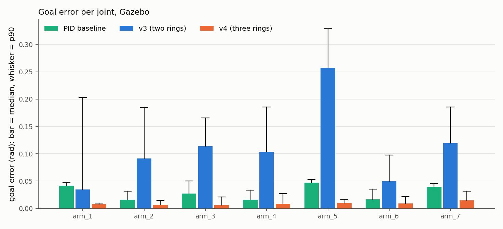
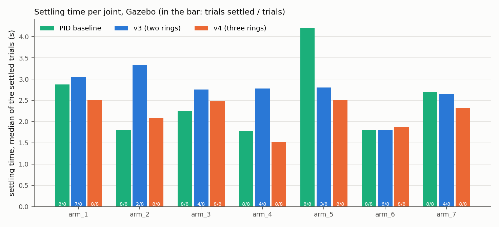
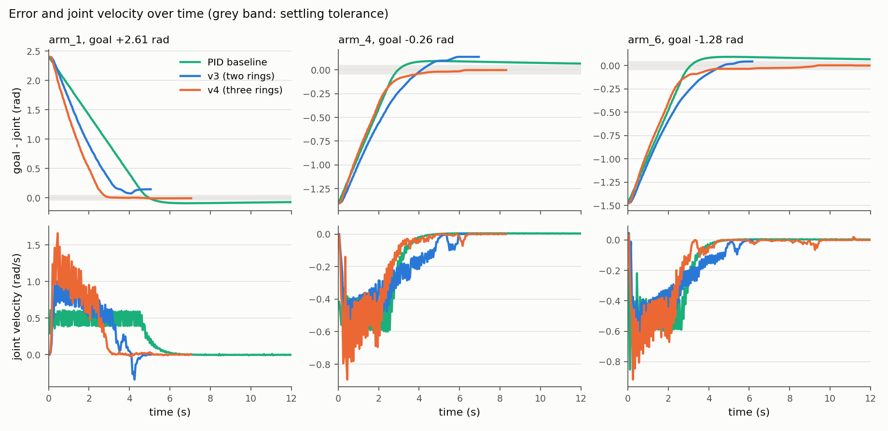
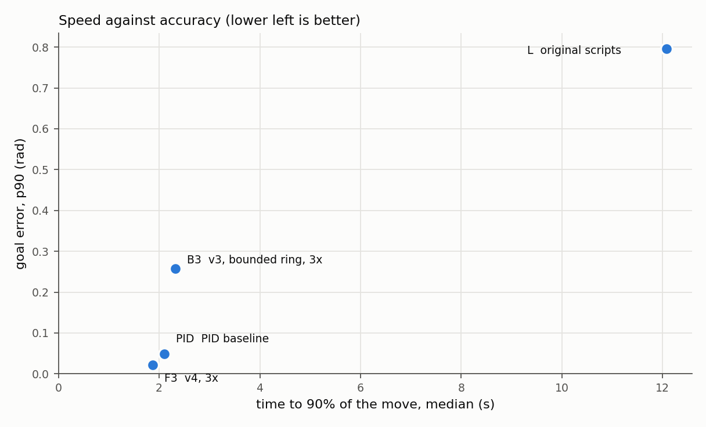
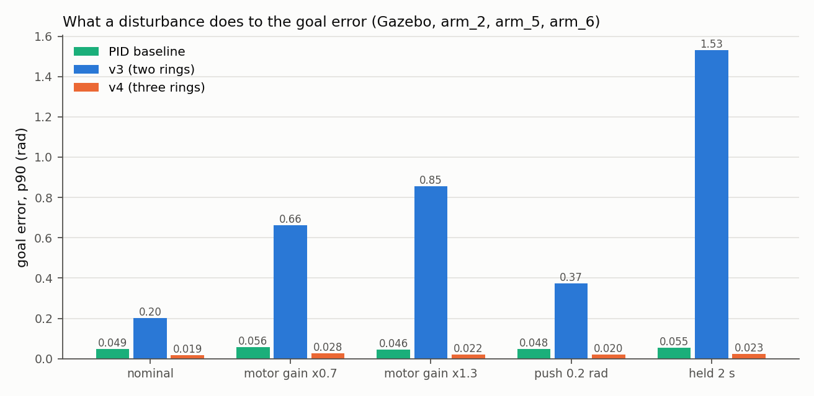

# Results: v3 and v4 against the PID baseline

Date: 2026-10-04, branch `velocity-calibration`. Real NEST `HEAD@41892a5`,
Gazebo 11 headless from the pinned image. Joints are named `arm_1`..`arm_7`.
What the versions are: [`architecture.md`](architecture.md). How to rerun any of
this: the top-level [`README.md`](../README.md), section 6. Every table in full:
[`results/tables.md`](results/tables.md); the trials:
[`results/data/`](results/data/README.md). Random starts, poses and goals:
[`stress-test.md`](stress-test.md). Earlier variants and reports:
[`archive/`](archive/README.md).

## Summary

- **v4 reaches the goal to about one ring index on every joint.** Over all
  seven arm joints in Gazebo it ends 0.008 rad from the goal in the median,
  0.022 rad at the 90th percentile and 0.045 rad at most, and settles in 100%
  of the trials.
- **v4 against v3.** v3 (two rings) ends 0.091 / 0.257 / 0.344 rad from the
  goal and settles in 54% of the trials: v4 has about 11 times less error. On
  the same goals v4 is closer in 93% of them.
- **v4 against the PID baseline.** The PID of the draft ends 0.027 / 0.048 /
  0.054 rad from the goal. v4 is closer on every joint, in 87% of the goals,
  and overshoots less (p90 0.023 rad against 0.093). Both settle in 100% of
  the trials, in about the same time (2.35 s and 2.23 s).
- **Under disturbance v4 behaves like the PID baseline, v3 does not.** With the
  motor gain 30% low or high, after a 0.2 rad push, or with the joint held for
  2 s, v4's p90 error stays between 0.020 and 0.028 rad and the PID baseline's
  between 0.046 and 0.056 rad; both settle in 100% of the trials. v3's p90
  error goes to 0.373-1.530 rad. v4 needs no calibrated motor gain.
- **Limits.** v4 is exact to about half a ring index (0.4 in the median, 1.0
  at p90) and repeats a goal to 0.0133 rad, where the other systems repeat to
  under 0.002 rad. The PID baseline uses one fixed set of gains for all joints
  and was not optimised; controllers tuned for these joints are more exact
  than v4 (section 9).

## 1. What was compared

| Key | System | Uses the measured joint | Settings |
| --- | --- | --- | --- |
| L | the frozen original ring scripts | once, at the start | hand gains of the draft |
| **PID** | **the PID baseline: the PID of the draft**, a three-term PID | every tick | fixed gains for every joint: kp 2.0, ki 0.1, kd 0.05, integral limit 2.0, output limit 0.5 rad/s |
| B3 | v3: two rings on the bounded ring, 3 NEST steps per tick | once, at the start | transport calibration on NEST |
| F3 | v4: three rings with body feedback, 3 NEST steps per tick | all the time, through the state ring | 115 sweeps on NEST, on arm_6 and arm_5 |

Rules that are the same for every system:

- **Goals:** per joint the same 8 goals from the reset pose, between 5% and 95%
  of the joint range, on both sides of the start: 56 trials per system. MoveIt
  reported none in self-collision.
- **Sample time:** 50 ms. The graph systems (v3, v4) run lock-stepped with the
  simulation; the two frozen scripts (L, PID) run their own real-time loop, as
  in the draft.
- **Start of a trial:** the reset motion, then the robot's base is put back at
  its spawn pose (it is not anchored; section 8).
- **End of a trial:** each controller's own stop rule (v3, the original
  scripts: no drive for 0.5 s; v4: no drive for 2 s; PID: error under 0.01 rad
  for 0.5 s), or 20 s; then the joint is stopped and its final angle read.
- **Scoring:** one function for all (`evaluation/motion.py`), from the joint
  angle every 50 ms. *Goal error*: |goal - final angle|. *Settled*: the error
  stays under 0.05 rad for 5 samples (the draft's definition); *settling time*:
  the first time it does. *Time to 90%*: when 90% of the distance travelled is
  covered. *Overshoot*: furthest excursion past the goal.
- **Tuning:** nothing was tuned on the comparison goals.

## 2. All joints

| System | Goal error, median / p90 / max (rad) | 95% interval of the median | Settled | Settling time, median (s) | Time to 90%, median (s) | Overshoot, p90 / max (rad) |
| --- | --- | --- | ---: | ---: | ---: | --- |
| L, original scripts | 0.260 / 0.796 / 1.211 | 0.206 - 0.369 | 29% | 13.30 | 12.07 | 0.135 / 0.308 |
| **PID baseline** | 0.027 / 0.048 / 0.054 | 0.019 - 0.035 | 100% | 2.23 | 2.10 | 0.093 / 0.093 |
| B3, v3 | 0.091 / 0.257 / 0.344 | 0.073 - 0.132 | 54% | 2.85 | 2.33 | 0.206 / 0.344 |
| **F3, v4** | 0.008 / 0.022 / 0.045 | 0.006 - 0.011 | 100% | 2.35 | 1.88 | 0.023 / 0.050 |

56 trials each; the interval is a bootstrap over trials. No system went the
wrong way and no reset failed. The original scripts produced no motion in 2
trials; v3's command hit the velocity limit in 2.

v4 against each other system **on the same goals** (paired; 54 goals, two of
the 56 trials repeat a goal):

| v4 against | Median of (v4 error - other error) (rad) | v4 closer in | Other closer in | Sign test p | Reading |
| --- | ---: | ---: | ---: | ---: | --- |
| original scripts | -0.247 | 100% | 0% | under 0.001 | v4 is closer |
| PID baseline | -0.014 | 87% | 13% | under 0.001 | v4 is closer |
| v3 | -0.076 | 93% | 7% | under 0.001 | v4 is closer |

Reading it:

- **From the original scripts to v3** (bounded ring, calibrated decoder) the
  error falls about 3 times; **from v3 to v4** (body feedback, sharp
  comparison) another 11 times.
- **v4 and the PID baseline** settle every trial in about the same time. v4
  ends closer to the goal and overshoots less. The baseline's error grows with
  the length of the move (shown in [`stress-test.md`](stress-test.md)):
  its integral term accumulates while its output is at the 0.5 rad/s limit,
  and it then parks a little past the goal.

## 3. Per joint

Goal error, median / p90 (rad):

| Joint | L | PID baseline | v3 | v4 |
| --- | --- | --- | --- | --- |
| arm_1 | 0.231 / 0.344 | 0.041 / 0.048 | 0.035 / 0.203 | 0.008 / 0.010 |
| arm_2 | 0.139 / 0.310 | 0.016 / 0.032 | 0.091 / 0.185 | 0.007 / 0.015 |
| arm_3 | 0.574 / 0.914 | 0.027 / 0.050 | 0.114 / 0.165 | 0.006 / 0.021 |
| arm_4 | 0.085 / 0.290 | 0.016 / 0.033 | 0.103 / 0.185 | 0.008 / 0.027 |
| arm_5 | 0.704 / 1.080 | 0.047 / 0.053 | 0.257 / 0.330 | 0.010 / 0.016 |
| arm_6 | 0.155 / 0.384 | 0.017 / 0.036 | 0.050 / 0.098 | 0.009 / 0.022 |
| arm_7 | 0.442 / 0.652 | 0.040 / 0.046 | 0.120 / 0.186 | 0.015 / 0.031 |

Settling time, median in s (trials settled of 8):

| Joint | L | PID baseline | v3 | v4 |
| --- | --- | --- | --- | --- |
| arm_1 | 14.6 (2/8) | 2.9 (8/8) | 3.1 (7/8) | 2.5 (8/8) |
| arm_2 | 9.0 (7/8) | 1.8 (8/8) | 3.3 (2/8) | 2.1 (8/8) |
| arm_3 | - (0/8) | 2.2 (8/8) | 2.8 (4/8) | 2.5 (8/8) |
| arm_4 | 12.7 (3/8) | 1.8 (8/8) | 2.8 (4/8) | 1.5 (8/8) |
| arm_5 | - (0/8) | 4.2 (8/8) | 2.8 (3/8) | 2.5 (8/8) |
| arm_6 | 15.1 (3/8) | 1.8 (8/8) | 1.8 (6/8) | 1.9 (8/8) |
| arm_7 | 13.9 (1/8) | 2.7 (8/8) | 2.6 (4/8) | 2.3 (8/8) |

v4 is closer to the goal than the PID baseline on every joint (median and
p90). The baseline settles sooner on arm_2, arm_3 and arm_6, v4 on the other
four. In ring indices v4's error is about the same on every joint (median
0.2-0.5, p90 0.5-1.4). One index is 0.020 rad on arm_6 and 0.034 rad on
arm_3, so the same index error is more radians on the wide joints (arm_3,
arm_5, arm_7).

## 4. One move over time

The longest move that all three systems made on arm_1, arm_4 and arm_6. v3
stops when its bumps agree, wherever the joint is. The PID overshoots and
comes back slowly. v4 slows down as it arrives and keeps correcting until the
joint is within about one index; its velocity is noisier because its decoder
filter is short (0.05 s against 0.15 s in v3).

## 5. Disturbances: what the body feedback buys

arm_2, arm_5, arm_6, six goals each, 18 trials per cell, the same goals for the
three systems.

- *Motor gain x0.7 / x1.3*: the velocity that reaches the joint is 0.7 or 1.3
  times what the controller asked for.
- *Pushed*: the commanded position is shifted by 0.2 rad one second into the
  move, without the controller being told.
- *Held*: the commands are dropped for 2 s from one second into the move; the
  joint stays where it is.

For v3 and v4 these act inside the loop (`cosim/disturbance.py`); for the PID
baseline they are applied around the frozen script's command call
(`run_legacy_trials.py`: `LegacyDisturbance`), with the same meaning.

Goal error, median / p90 / max (rad), and the share of trials settled:

| Condition | PID baseline | v3 | v4 |
| --- | --- | --- | --- |
| nominal | 0.022 / 0.049 / 0.054, 100% | 0.069 / 0.202 / 0.286, 50% | 0.011 / 0.019 / 0.046, 100% |
| motor gain x0.7 | 0.033 / 0.056 / 0.064, 100% | 0.314 / 0.662 / 1.215, 6% | 0.013 / 0.028 / 0.039, 100% |
| motor gain x1.3 | 0.017 / 0.046 / 0.049, 100% | 0.203 / 0.855 / 0.950, 33% | 0.010 / 0.022 / 0.024, 100% |
| pushed 0.2 rad | 0.022 / 0.048 / 0.053, 100% | 0.234 / 0.373 / 0.485, 11% | 0.009 / 0.020 / 0.031, 100% |
| held for 2 s | 0.041 / 0.055 / 0.060, 100% | 0.533 / 1.530 / 2.224, 0% | 0.007 / 0.023 / 0.038, 100% |

Time to 90% of the move, median (s):

| Condition | PID baseline | v3 | v4 |
| --- | ---: | ---: | ---: |
| nominal | 1.93 | 2.50 | 1.98 |
| motor gain x0.7 | 2.75 | 2.48 | 2.80 |
| motor gain x1.3 | 1.50 | 2.38 | 1.33 |
| pushed 0.2 rad | 2.05 | 2.50 | 1.83 |
| held for 2 s | 3.95 | 0.98 | 3.93 |

- **v4 and the PID baseline both correct every disturbance**, because both
  read the joint all the time: every trial settles, and the error stays in
  the range it has without the disturbance. v4's error is about half the baseline's in
  every condition.
- **v3 cannot**, because it reads the joint once. Its accuracy *is* its motor
  gain; it never notices the push; and while the joint is held its bump runs
  to the goal and the trial ends with the joint wherever it was.
- With the gain 30% high v4 overshoots before it settles (p90 0.199 rad,
  largest 0.357); the PID baseline's overshoot stays at 0.094 rad.
- A wrong motor gain changes the speed of both feedback controllers, not their
  end point (time to 90%: 2.80 s and 2.75 s at x0.7, 1.33 s and 1.50 s at x1.3).

## 6. Repeatability

Three runs of the same goal, range of the final angle (8 goals on arm_6, arm_5,
arm_2, arm_7):

| System | Median range (rad) | Largest (rad) |
| --- | ---: | ---: |
| original scripts | 0.0005 | 0.0017 |
| PID baseline | 0.0001 | 0.0018 |
| v3 | 0.0003 | 0.0016 |
| v4 | 0.0133 | 0.0272 |

v4's end point varies by about half a ring index from run to run; the other
systems repeat to under 0.002 rad. The cause was not isolated: the network
seed is the same in the three runs, so it is likely the small run-to-run
differences in simulation timing acting on a controller whose state ring only
reports the joint in steps of one index.

## 7. v4 on NEST (simulated joint)

All joints, three start poses, three seeds, eight goals (504 trials per system):

| | v3 | v4 |
| --- | --- | --- |
| Goal error, median / p90 / max (rad) | 0.063 / 0.194 / 0.531 | 0.011 / 0.027 / 0.050 |
| Settled | 65% | 100% |
| Goals exactly at the joint limits (12 trials) | 0.167 / 0.301 / 0.481 | 0.011 / 0.023 / 0.039 |
| Bumps lost, wrong way | 0 | 0 |

NEST and Gazebo agree for v4 (p90 0.027 against 0.022 rad). How v4's settings
were found, and the disturbance runs on NEST: [`v4-tuning.md`](v4-tuning.md).

## 8. What to keep in mind

- **The PID baseline has fixed gains.** One set (kp 2.0, ki 0.1, kd 0.05) for
  all seven joints, as in the draft; it was not optimised per joint. The
  comparison says how v4 stands next to that familiar reference, not how the
  ring controller stands next to the best conventional controller (section 9).
- **The base of the robot is not anchored.** An arm that pushes on the table
  shoves the whole robot (in one session by 0.23 m and 13 degrees, after which
  arm_3 stopped at -1.52 rad whatever the goal). Every trial here starts by
  putting the base back and records how far the trial moved it; no trial of
  this comparison moved it by more than 7 mm. The archived earlier reports did
  not do this.
- **MoveIt screening checks self-collision, not the table**, and evaluates the
  other joints at the reset pose.
- **v4's settings were tuned on NEST**, on arm_6 and arm_5, then run unchanged
  in Gazebo on all joints.
- **Simulation only.** The simulated position controller follows its command
  with 5-14 ms of lag. Nothing was run on the robot.

## 9. Upper reference: controllers tuned for these joints

To know how far conventional position control can go on the same joints and
goals, two more controllers were run. They are not baselines of the paper;
they mark the ceiling.

| Controller | Goal error, median / p90 / max (rad) | Settled | Settling time, median (s) |
| --- | --- | ---: | ---: |
| Tuned controller in the same 50 ms loop as v4 (`scripts/run_baselines.py --controller p`) | 0.0000 / 0.0002 / 0.0005 | 100% | 0.85 |
| The robot's own joint trajectory controller, given the goal directly | 0.001 / 0.005 / 0.006 | 100% | 0.95 |
| v4, for comparison | 0.008 / 0.022 / 0.045 | 100% | 2.35 |

- The tuned controller came out of a grid of 70 settings on arm_6 and arm_5
  (`kp`, `ki`, `kd`, and the output limit as a share of the joint's velocity
  limit; `results/data/pid_tuning.json`). The grid chose `kp` 8 with no
  integral and no derivative term at 60% of the velocity limit: in effect a
  proportional controller. The integral term is not needed because the
  velocity command is integrated into a position, so the loop already contains
  an integrator; at full speed every setting overshot (0.09-0.33 rad) because
  the joint cannot follow the streamed position at its velocity limit.
- Both are more exact than v4, settle faster and repeat to under 0.001 rad. v4's
  accuracy is bounded by the ring's resolution; theirs is not.
- Under the disturbances of section 5 the tuned controller stays within
  0.0004 rad at p90 (its rows are in `results/tables.md`, section 5). In the stress test it was exact in 299 of 300 random
  trials and oscillated in one (arm_2), where a gain tuned on two wrist joints
  was too high.
- The robot's own controller receives a trajectory whose duration we chose
  (distance over half the velocity limit), so its settling time is not a
  property of the controller.

## 10. The claims and what supports them

| Claim | Evidence | Limit |
| --- | --- | --- |
| v4 reaches the goal to about one ring index on every joint | section 2 (0.008 / 0.022 / 0.045 rad, 56 trials), section 3, stress test (300 random trials: 0.012 / 0.033 / 0.060 rad) | one joint moving at a time; simulation |
| v4 is more accurate than v3 | paired test, section 2: closer in 93% of the goals, p under 0.001; every joint in section 3 | both at 3 NEST steps per tick |
| v4 settles in every trial of the comparison, v3 in about half | section 2: 100% against 54% | in the stress test v4 settles in 99% (296 of 300) |
| v4 is more accurate than the PID baseline and settles as fast | section 2: closer in 87% of the goals, p under 0.001; settling 2.35 s against 2.23 s; every joint in section 3 | the baseline has fixed, unoptimised gains; in the stress test v4 is closer in 61% of the trials, and the baseline is closer on short moves |
| v4 needs no motor calibration | section 5: p90 0.028 and 0.022 rad with the gain x0.7 and x1.3; its decoder gain is not fitted | tested to +-30%; at x1.3 it overshoots by up to 0.357 rad first |
| v4 recovers from a push and from a held joint | section 5: p90 0.020 and 0.023 rad, all settled | one push size (0.2 rad), one hold (2 s) |
| Under disturbance v4 is as robust as the PID baseline and more accurate | section 5: both settle in 100% of the trials in all five conditions; v4's p90 error is 0.019-0.028 rad, the baseline's 0.046-0.056 | 18 trials per condition, three joints |
| The ring projection removes the comparator's blind band | `results/figures/blind_band.png`: 10-21 indices without drive, 0-1 with the projection | measured with the bump frozen, on NEST |

Not claimed, because not supported: that the ring controller outperforms PID
control in general (controllers tuned for these joints are more exact, section
9); that the results carry over to the real robot.

## 11. Acceptance criteria of v4

Written before v4 was run in Gazebo. All met.

| Criterion | Target | v3 | v4 |
| --- | --- | --- | --- |
| Bumps lost, wrong-way or clamped trials | 0 | 2 clamped | 0 |
| Goal error, all joints, median / p90 | at most 0.045 / 0.12 rad | 0.091 / 0.257 | 0.008 / 0.022 |
| Goal error p90 with the motor gain x0.7 / x1.3 | within 1.5 times the nominal p90 (0.019 rad) | 0.662 / 0.855 | 0.028 / 0.022 |
| Predicted bump to goal bump at rest, median | at most 1 index | - | 0.38 |
| Goal bump to goal index at rest, median | at most 1 index | - | 0.50 |
| Time to 90% of the move, median | at most 1.5 times v3's | 2.33 s | 1.88 s |
| Goal error p90 after a 0.2 rad push | back at the nominal error | 0.373 | 0.020 |

## 12. Recordings

In [`results/videos/`](results/videos/); the numbers of each recorded v3/v4
trial are in `results/videos/trials.json`. Overhead camera, one frame per 50 ms
tick (the two frozen scripts: 20 frames per second of wall time).

| File | Shows |
| --- | --- |
| `all_systems_arm6.mp4` | arm_6 to -0.992 rad with the original scripts, the PID baseline, v3 and v4 in a 2 x 2 grid. Final errors: 0.039, 0.032, 0.074, 0.000 rad |
| `v3_vs_v4_arm2.mp4`, `v3_vs_v4_arm5.mp4`, `v3_vs_v4_arm6.mp4` | v3 (left) and v4 (right) on the same goal. Final errors v3 / v4: 0.031 / 0.009, 0.270 / 0.027, 0.074 / 0.000 rad |
| `gain07_pid_v3_v4_arm6.mp4` | the arm_6 move with the motor gain 30% low, PID baseline, v3 and v4 side by side: the PID ends 0.046 rad off, v3 stops 0.304 rad short, v4 arrives (0.005 rad) |
| `push_pid_v3_v4_arm6.mp4` | the joint pushed 0.2 rad one second into the move, the same three systems: the PID ends 0.039 rad off, v3 0.127 rad, v4 0.006 rad |
| `v4_all_joints.mp4` | v4 on each of the seven joints (errors 0.000-0.027 rad) |
| `upper_reference_v3_v4_arm6.mp4` | the upper references of section 9 next to v3 and v4 on the same move |

## 13. Paper-ready outputs

In [`results/paper/`](results/paper/), each as PNG and PDF:

| File | Corresponds to |
| --- | --- |
| `architecture_v3`, `architecture_v4` | the architecture diagram, as built |
| `error_by_joint` | error per joint (Figure 5 of the draft), with the PID baseline, v3 and v4 |
| `settling_time` | settling time against PID (Figure 7) |
| `traces` | error and velocity over time on arm_1, arm_4, arm_6 (Figure 8) |
| `robustness` | goal error under disturbances: the PID baseline, v3 and v4 |
| `blind_band` | the comparator's blind band without and with the ring projection |
| `numbers.md` | the numbers a text would quote, on one page |

The draft itself was not edited. Its architecture section describes v3; for v4
it would need the third ring, the second gain pair, the ring-to-gain projection
and the corrective encoders ([`architecture.md`](architecture.md)).
