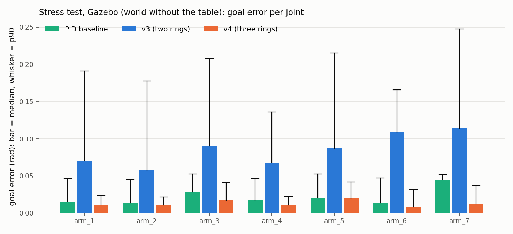
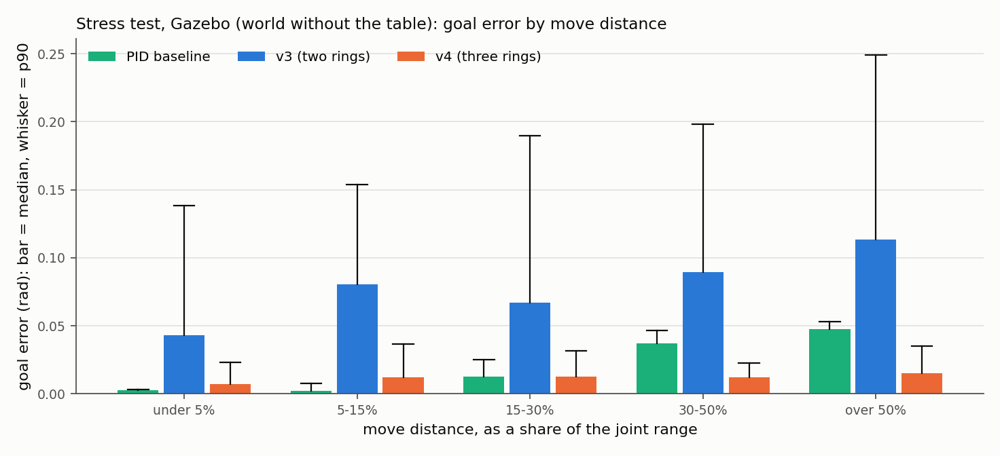
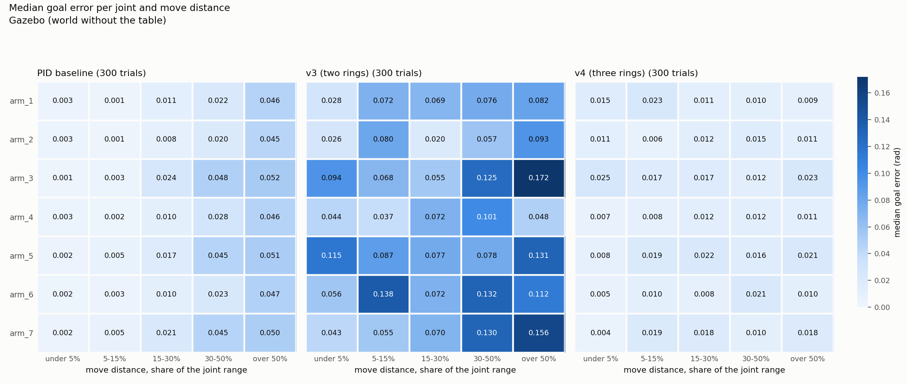
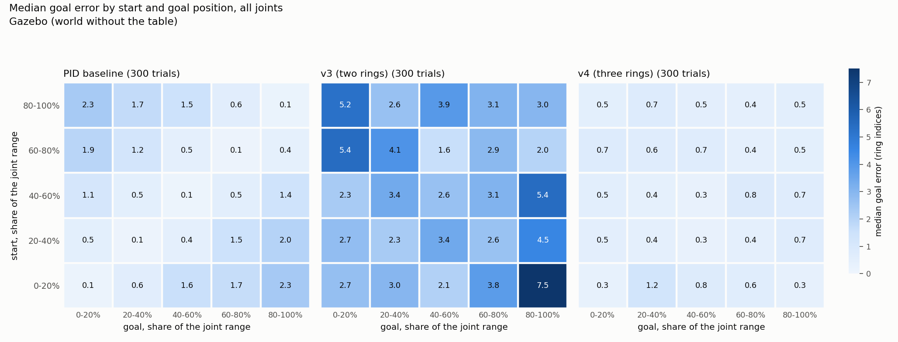
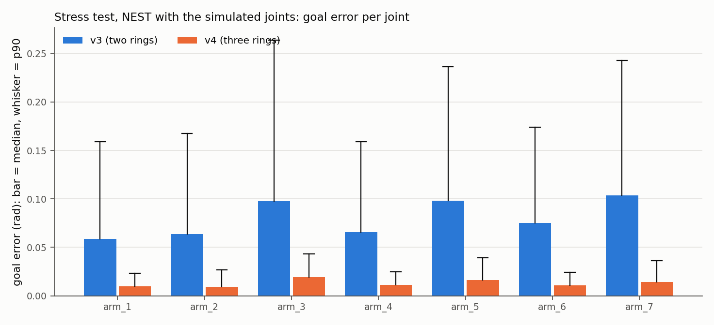
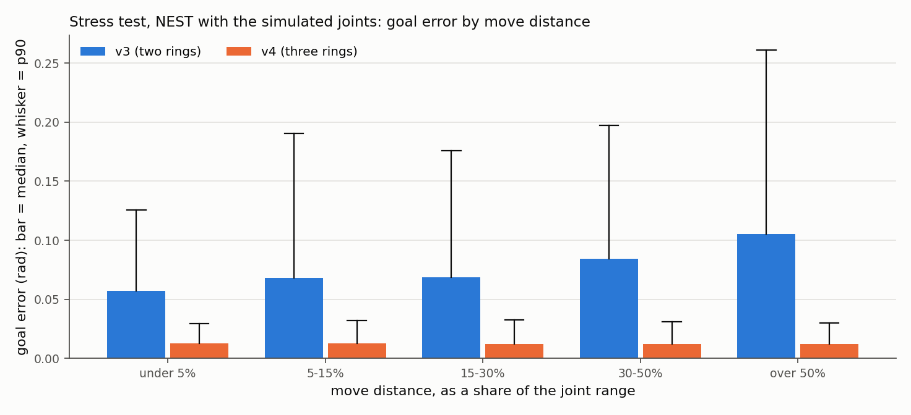
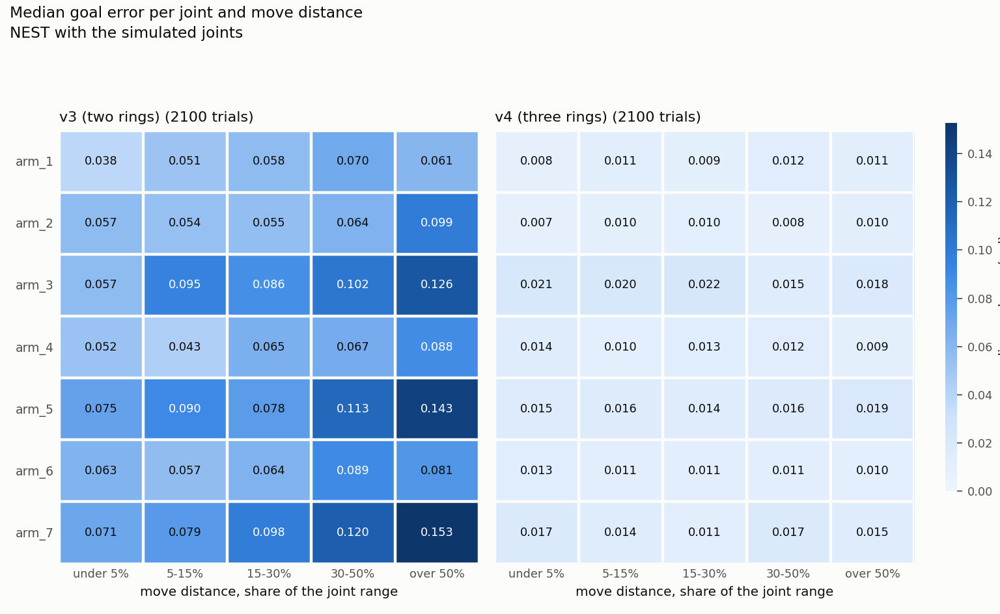
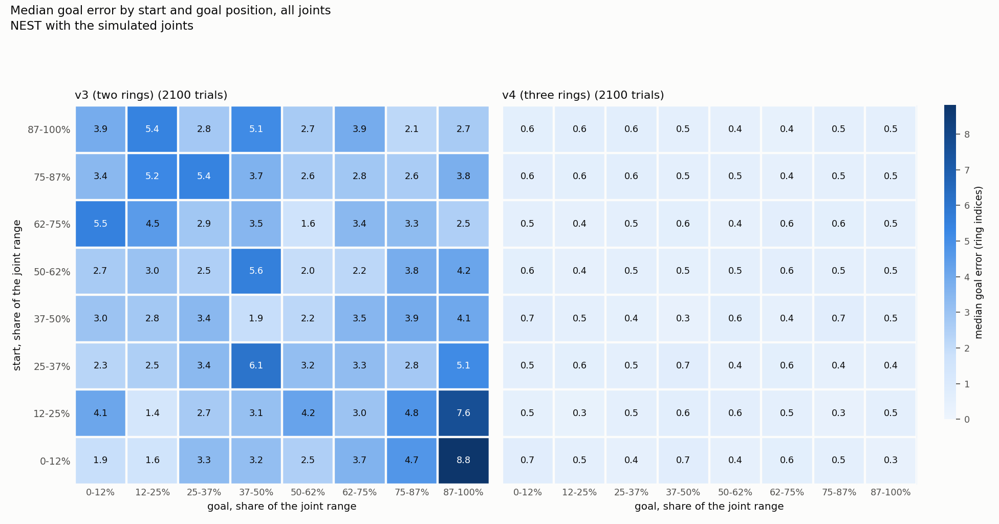

# Stress test tables

Written by `scripts/stress_test.py report`; the reading is in [`../../stress-test.md`](../../stress-test.md). Every trial: a random joint, a random start and goal anywhere in its range, the other six joints at random angles, a random network seed. Goal error is |goal - final joint angle|; settled: under 0.05 rad for 5 samples.

## How the numbers are calculated

**Angles as a percentage of the joint range.** Every joint has a lower and an upper limit (`velocity_calibration.json`). A position is written as a share of that range: `share = (angle - lower limit) / (upper limit - lower limit)`. 0% is the lower limit, 100% the upper limit, 50% the middle. Example: arm_6 goes from -1.417 to +1.417 rad, so +0.709 rad is (0.709 + 1.417) / 2.834 = 75%. Shares make joints with different ranges comparable (arm_3 spans 4.8 rad, arm_6 2.8 rad).

**Start and goal.** Each trial draws the start share and the goal share of the driven joint independently and uniformly between 0% and 100%. The planned start is where the arm is put before the trial; the tables use the angle actually measured at the first tick.

**Move distance.** `|goal share - start share|`, the part of the joint's range the move has to cover. A move from 20% to 65% is a 45% move, whichever joint it is. Trials are grouped into five bins: under 5% (0% to 5%), 5-15% (5% to 15%), 15-30% (15% to 30%), 30-50% (30% to 50%), over 50% (50% to 100%). A value on a bin edge goes into the higher bin. Because start and goal are drawn independently, short moves are rarer than long ones, so the bins hold different numbers of trials (given in the tables).

**Goal error (rad).** `|goal angle - final joint angle|`, the final angle being measured after the trial has ended and the joint has stopped. Always positive.

**Goal error in ring indices.** The goal error divided by the joint's radians per ring index (`rho`): how many neurons of the 200-neuron ring the joint is away from the goal. On the bounded ring the joint range lies on 140 indices, so `rho = range / 140`: 0.020 rad for arm_6, 0.034 rad for arm_3. An error of 0.5 index is 0.010 rad on arm_6 and 0.017 rad on arm_3. PID has no ring; its error is divided by the same `rho` only so that it can be shown on the same scale.

**Median, p90, max.** Of the trials in a group, sorted by goal error: the median is the middle one (half the trials are better), p90 the value that 90% of the trials stay under (one trial in ten is worse), max the single worst trial.

**Within 0.05 rad (%).** Trials whose goal error is under 0.05 rad, divided by all trials of that system, times 100.

**Settled (%).** Trials in which the error stayed under 0.05 rad for 5 consecutive samples (0.25 s) at some point during the trial, divided by all trials, times 100. A trial can count as settled and still end outside 0.05 rad if the joint drifts out again afterwards (this happens with PID); 'within 0.05 rad' is about the end of the trial.

**Settling time.** The first time from which the error stays under 0.05 rad for 5 samples; the median over the settled trials.

**Overshoot.** The furthest the joint went past the goal in its direction of travel; 0 if it never passed it.

**Counts.** *Bumps lost*: the predictive (v4) ring went silent. *Wrong way*: the joint moved over 0.03 rad away from the goal. *No drive*: the joint moved less than 0.03 rad in total (this includes trials whose goal was that close). *Clamped*: the command hit the joint's velocity limit or a joint limit in at least one tick. *Base moved*: the robot's base shifted over 1 cm during the trial. *Start off*: the arm was more than 0.02 rad from the planned start. *Reset failed*: the reset motion could not be run and the trial was skipped.

## Gazebo (world without the table)

Plan: 300 trials, seed 1, 62 draws rejected by MoveIt.

| system | trials | goal error, median / p90 / max (rad) | in ring indices | within 0.05 rad | settled | settling time, median (s) | overshoot, p90 / max (rad) | bumps lost | wrong way | no drive | clamped | base moved over 1 cm | start off by over 0.02 rad | reset failed |
|---|---:|---|---|---:|---:|---:|---|---:|---:|---:|---:|---:|---:|---:|
| PID baseline | 300 | 0.019 / 0.049 / 0.057 | 0.84 / 2.28 / 2.52 | 93% | 100% | 1.95 | 0.093 / 0.093 | 0 | 0 | 6 | 0 | 0 | 0 | 0 |
| upper reference: tuned controller | 300 | 0.0000 / 0.0001 / 0.2064 | 0.000 / 0.004 / 10.855 | 100% | 100% | 0.80 | 0.001 / 0.221 | 0 | 0 | 6 | 0 | 0 | 0 | 0 |
| upper reference: robot's own controller | 300 | 0.001 / 0.004 / 0.007 | 0.03 / 0.23 / 0.39 | 100% | 100% | 0.90 | 0.003 / 0.009 | 0 | 0 | 5 | 0 | 0 | 0 | 0 |
| v3 (two rings) | 300 | 0.081 / 0.204 / 0.563 | 3.40 / 8.17 / 18.79 | 32% | 60% | 2.40 | 0.154 / 0.563 | 0 | 0 | 26 | 7 | 0 | 0 | 0 |
| v4 (three rings) | 300 | 0.012 / 0.033 / 0.060 | 0.53 / 1.24 / 2.00 | 98% | 99% | 2.15 | 0.038 / 0.144 | 0 | 0 | 7 | 6 | 0 | 0 | 0 |

### v4 against each other system on the same trials (paired)

Per trial, v4's goal error minus the other system's. 'Closer in': the share of trials in which that system ended nearer the goal. Sign test p under 0.05 is read as a real difference.

| v4 against | shared trials | median of (v4 error - other error) (rad) | v4 closer in | other closer in | sign test p | reading |
|---|---:|---:|---:|---:|---:|---|
| PID baseline | 300 | -0.007 | 61% | 39% | under 0.001 | v4 is closer |
| upper reference: tuned controller | 300 | +0.012 | 0% | 100% | under 0.001 | upper reference: tuned controller is closer |
| upper reference: robot's own controller | 300 | +0.011 | 7% | 93% | under 0.001 | upper reference: robot's own controller is closer |
| v3 (two rings) | 300 | -0.069 | 93% | 7% | under 0.001 | v4 is closer |

### Goal error per joint, median / p90 (rad)

| joint | trials | PID baseline | upper reference: tuned controller | upper reference: robot's own controller | v3 (two rings) | v4 (three rings) |
|---|---:|---|---|---|---|---|
| arm_1 | 45 | 0.015 / 0.046 | 0.0001 / 0.0002 | 0.0000 / 0.0001 | 0.071 / 0.191 | 0.011 / 0.024 |
| arm_2 | 44 | 0.013 / 0.045 | 0.0000 / 0.0001 | 0.005 / 0.007 | 0.058 / 0.177 | 0.011 / 0.021 |
| arm_3 | 33 | 0.029 / 0.052 | 0.0000 / 0.0000 | 0.001 / 0.002 | 0.090 / 0.208 | 0.017 / 0.041 |
| arm_4 | 42 | 0.017 / 0.046 | 0.0000 / 0.0000 | 0.002 / 0.002 | 0.068 / 0.136 | 0.010 / 0.022 |
| arm_5 | 47 | 0.020 / 0.052 | 0.0000 / 0.0000 | 0.001 / 0.002 | 0.087 / 0.215 | 0.019 / 0.041 |
| arm_6 | 43 | 0.013 / 0.047 | 0.0000 / 0.0000 | 0.002 / 0.004 | 0.108 / 0.166 | 0.008 / 0.032 |
| arm_7 | 46 | 0.045 / 0.052 | 0.0000 / 0.0000 | 0.0000 / 0.0000 | 0.113 / 0.248 | 0.012 / 0.037 |

### Goal error by move distance, median / p90 (rad)

| move, share of the range | trials | PID baseline | upper reference: tuned controller | upper reference: robot's own controller | v3 (two rings) | v4 (three rings) |
|---|---:|---|---|---|---|---|
| under 5% | 26 | 0.003 / 0.003 | 0.0000 / 0.0001 | 0.001 / 0.004 | 0.043 / 0.138 | 0.007 / 0.023 |
| 5-15% | 47 | 0.002 / 0.007 | 0.0000 / 0.0001 | 0.001 / 0.004 | 0.080 / 0.154 | 0.012 / 0.037 |
| 15-30% | 81 | 0.013 / 0.025 | 0.0000 / 0.0001 | 0.001 / 0.004 | 0.067 / 0.190 | 0.013 / 0.032 |
| 30-50% | 70 | 0.037 / 0.046 | 0.0000 / 0.0001 | 0.001 / 0.005 | 0.090 / 0.198 | 0.012 / 0.023 |
| over 50% | 76 | 0.048 / 0.053 | 0.0000 / 0.0001 | 0.001 / 0.004 | 0.114 / 0.249 | 0.015 / 0.035 |

### The ten largest v4 errors

| trial | joint | start (rad) | goal (rad) | final (rad) | error (rad) | error (indices) | move (% of range) | steps | settled | other joints (rad) |
|---:|---|---:|---:|---:|---:|---:|---:|---:|---|---|
| 146 | arm_7 | -1.493 | -0.494 | -0.554 | +0.060 | 2.0 | 24 | 112 | no | +0.85 +0.40 +0.91 +1.75 +0.10 +0.11 |
| 91 | arm_3 | -1.633 | -2.760 | -2.704 | -0.056 | 1.6 | 23 | 109 | no | +2.75 +0.03 +2.08 -2.03 -0.56 +1.06 |
| 206 | arm_3 | -2.658 | -2.286 | -2.342 | +0.056 | 1.6 | 8 | 71 | no | +0.13 -1.02 +1.97 +1.71 +0.64 +1.48 |
| 182 | arm_5 | +1.444 | -0.197 | -0.251 | +0.054 | 1.8 | 39 | 80 | yes | +0.46 +0.97 -0.56 +0.42 +1.27 +0.20 |
| 52 | arm_3 | +0.755 | -2.670 | -2.618 | -0.052 | 1.5 | 71 | 135 | no | +2.01 +0.64 +0.35 +2.04 -0.31 -0.01 |
| 103 | arm_7 | +0.672 | -0.385 | -0.430 | +0.045 | 1.5 | 25 | 123 | yes | +2.43 +0.91 -2.79 +0.82 -0.34 +0.93 |
| 112 | arm_7 | -1.259 | -0.116 | -0.161 | +0.045 | 1.5 | 27 | 157 | yes | +2.17 -1.04 -3.46 +1.36 -0.75 -0.77 |
| 107 | arm_7 | +1.668 | +2.051 | +2.095 | -0.044 | 1.5 | 9 | 288 | yes | +0.06 -1.47 -1.08 +1.18 +0.45 +1.07 |
| 258 | arm_5 | -1.295 | -1.920 | -1.876 | -0.043 | 1.5 | 15 | 131 | yes | +0.14 -0.32 -0.19 +0.38 -0.76 -2.00 |
| 186 | arm_5 | -0.367 | -1.735 | -1.692 | -0.043 | 1.4 | 33 | 123 | yes | +0.47 +0.00 -3.51 +1.93 -0.80 +1.87 |

### Figures

#### Bar plot: goal error per joint

- **Horizontal axis:** the driven joint, `arm_1` to `arm_7`. Each trial drives exactly one joint, so every trial is in one group.
- **Vertical axis:** goal error in rad.
- **Bar:** the median goal error of that system's trials on that joint. **Whisker** (the line with a cap above the bar): the p90 of the same trials.
- **Colours:** one per system (PID baseline, v3 (two rings), v4 (three rings)), the same in every figure.
- No percentage is involved; the number of trials per joint is in the per-joint table above.

#### Bar plot: goal error by move distance

- **Horizontal axis:** the move distance bin. The percentage is the move as a share of the joint's range, `|goal share - start share| x 100`: 'under 5%' holds the moves that cover less than a twentieth of the range, 'over 50%' the moves across more than half of it. All joints are pooled.
- **Vertical axis:** goal error in rad.
- **Bar and whisker:** median and p90 of the trials in that bin, per system.

#### Heat map: joint by move distance

- **One panel per system** (PID baseline, v3 (two rings), v4 (three rings)), all with the same colour scale so the panels can be compared directly.
- **Rows (vertical axis):** the driven joint. **Columns (horizontal axis):** the move distance bin, as in the bar plot above.
- **Cell:** the median goal error, in rad, of the trials of that joint whose move fell into that bin. The number is printed in the cell; the colour shows the same value (light = small error, dark = large; the bar on the right gives the scale, starting at 0). A blank cell had no trial.
- With seven joints and five bins the 300 trials are spread over 35 cells: about 9 trials per cell on average, fewer in the 'under 5%' column. The fewer trials a cell has, the rougher its median.

#### Heat map: start by goal

- **One panel per system**, same colour scale.
- **Rows (vertical axis):** where the driven joint started, as a share of its range, in 5 bands of 20% (bottom row = starts near the lower limit, top row = near the upper limit).
- **Columns (horizontal axis):** where the goal was, as a share of the range, in the same bands (left = goals near the lower limit, right = near the upper limit). The axis labels are rounded down to whole percent.
- **Cell:** the median goal error of the trials with that start band and that goal band, all joints pooled, in **ring indices** (not rad), so that joints with different ranges can share a cell. About 12 trials per cell.
- **Reading the position of a cell:** the diagonal from bottom left to top right holds the short moves (start and goal in the same band); the top-left and bottom-right corners hold the longest moves (from one end of the range to the other). Cells above the diagonal are moves downward (goal below start), cells below it moves upward.

## NEST with the simulated joints

Plan: 2100 trials, seed 1, not screened (no collisions in this simulator).

| system | trials | goal error, median / p90 / max (rad) | in ring indices | within 0.05 rad | settled | settling time, median (s) | overshoot, p90 / max (rad) | bumps lost | wrong way | no drive | clamped | base moved over 1 cm | start off by over 0.02 rad | reset failed |
|---|---:|---|---|---:|---:|---:|---|---:|---:|---:|---:|---:|---:|---:|
| v3 (two rings) | 2100 | 0.078 / 0.207 / 0.649 | 3.28 / 8.21 / 21.98 | 35% | 64% | 2.45 | 0.168 / 0.649 | 0 | 1 | 171 | 34 | 0 | 0 | 0 |
| v4 (three rings) | 2100 | 0.012 / 0.031 / 0.078 | 0.52 / 1.26 / 3.12 | 98% | 99% | 1.90 | 0.046 / 0.290 | 0 | 0 | 49 | 53 | 0 | 0 | 0 |

### v4 against each other system on the same trials (paired)

Per trial, v4's goal error minus the other system's. 'Closer in': the share of trials in which that system ended nearer the goal. Sign test p under 0.05 is read as a real difference.

| v4 against | shared trials | median of (v4 error - other error) (rad) | v4 closer in | other closer in | sign test p | reading |
|---|---:|---:|---:|---:|---:|---|
| v3 (two rings) | 2100 | -0.063 | 90% | 10% | under 0.001 | v4 is closer |

### Goal error per joint, median / p90 (rad)

| joint | trials | v3 (two rings) | v4 (three rings) |
|---|---:|---|---|
| arm_1 | 291 | 0.059 / 0.159 | 0.010 / 0.023 |
| arm_2 | 312 | 0.064 / 0.168 | 0.009 / 0.027 |
| arm_3 | 309 | 0.097 / 0.264 | 0.019 / 0.043 |
| arm_4 | 272 | 0.066 / 0.159 | 0.011 / 0.025 |
| arm_5 | 292 | 0.098 / 0.236 | 0.016 / 0.039 |
| arm_6 | 324 | 0.075 / 0.174 | 0.011 / 0.025 |
| arm_7 | 300 | 0.104 / 0.243 | 0.014 / 0.036 |

### Goal error by move distance, median / p90 (rad)

| move, share of the range | trials | v3 (two rings) | v4 (three rings) |
|---|---:|---|---|
| under 5% | 209 | 0.057 / 0.126 | 0.013 / 0.029 |
| 5-15% | 363 | 0.068 / 0.190 | 0.013 / 0.032 |
| 15-30% | 467 | 0.069 / 0.176 | 0.012 / 0.032 |
| 30-50% | 536 | 0.084 / 0.197 | 0.012 / 0.031 |
| over 50% | 525 | 0.105 / 0.261 | 0.012 / 0.030 |

### The ten largest v4 errors

| trial | joint | start (rad) | goal (rad) | final (rad) | error (rad) | error (indices) | move (% of range) | steps | settled | other joints (rad) |
|---:|---|---:|---:|---:|---:|---:|---:|---:|---|---|
| 2095 | arm_5 | +1.713 | -1.385 | -1.307 | -0.078 | 2.6 | 74 | 113 | no | +1.76 -0.18 -1.18 -0.14 +0.58 +0.23 |
| 920 | arm_3 | -2.828 | -2.185 | -2.263 | +0.078 | 2.3 | 13 | 67 | no | +0.12 -0.76 +0.29 -1.20 -0.72 +1.39 |
| 1606 | arm_7 | +1.369 | -0.157 | -0.227 | +0.070 | 2.3 | 36 | 140 | no | +1.50 -0.17 -3.25 +1.01 -0.34 -0.84 |
| 1490 | arm_3 | +1.033 | -1.581 | -1.651 | +0.069 | 2.0 | 55 | 97 | yes | +0.37 +0.95 -0.10 +0.91 +0.94 -1.62 |
| 389 | arm_5 | -0.536 | -0.077 | -0.145 | +0.068 | 2.3 | 11 | 87 | no | +1.81 +0.24 +0.79 +2.35 -0.58 +1.06 |
| 135 | arm_7 | -1.259 | -0.116 | -0.183 | +0.067 | 2.2 | 27 | 94 | no | +2.17 -1.04 -3.46 +1.36 -0.75 -0.77 |
| 53 | arm_5 | -0.985 | +1.176 | +1.111 | +0.065 | 2.2 | 52 | 400 | yes | +1.03 -0.36 +0.74 +0.76 -1.36 -0.89 |
| 1838 | arm_3 | -1.480 | -2.761 | -2.697 | -0.064 | 1.9 | 27 | 97 | no | +1.91 -0.75 +1.97 -1.47 -1.18 +0.98 |
| 131 | arm_6 | +0.331 | -0.432 | -0.368 | -0.063 | 3.1 | 27 | 77 | no | +1.29 +1.07 -0.18 -0.23 +1.72 -1.28 |
| 175 | arm_7 | -1.493 | -0.494 | -0.557 | +0.063 | 2.1 | 24 | 99 | no | +0.85 +0.40 +0.91 +1.75 +0.10 +0.11 |

### Figures

#### Bar plot: goal error per joint

- **Horizontal axis:** the driven joint, `arm_1` to `arm_7`. Each trial drives exactly one joint, so every trial is in one group.
- **Vertical axis:** goal error in rad.
- **Bar:** the median goal error of that system's trials on that joint. **Whisker** (the line with a cap above the bar): the p90 of the same trials.
- **Colours:** one per system (v3 (two rings), v4 (three rings)), the same in every figure.
- No percentage is involved; the number of trials per joint is in the per-joint table above.

#### Bar plot: goal error by move distance

- **Horizontal axis:** the move distance bin. The percentage is the move as a share of the joint's range, `|goal share - start share| x 100`: 'under 5%' holds the moves that cover less than a twentieth of the range, 'over 50%' the moves across more than half of it. All joints are pooled.
- **Vertical axis:** goal error in rad.
- **Bar and whisker:** median and p90 of the trials in that bin, per system.

#### Heat map: joint by move distance

- **One panel per system** (v3 (two rings), v4 (three rings)), all with the same colour scale so the panels can be compared directly.
- **Rows (vertical axis):** the driven joint. **Columns (horizontal axis):** the move distance bin, as in the bar plot above.
- **Cell:** the median goal error, in rad, of the trials of that joint whose move fell into that bin. The number is printed in the cell; the colour shows the same value (light = small error, dark = large; the bar on the right gives the scale, starting at 0). A blank cell had no trial.
- With seven joints and five bins the 2100 trials are spread over 35 cells: about 60 trials per cell on average, fewer in the 'under 5%' column. The fewer trials a cell has, the rougher its median.

#### Heat map: start by goal

- **One panel per system**, same colour scale.
- **Rows (vertical axis):** where the driven joint started, as a share of its range, in 8 bands of 12.5% (bottom row = starts near the lower limit, top row = near the upper limit).
- **Columns (horizontal axis):** where the goal was, as a share of the range, in the same bands (left = goals near the lower limit, right = near the upper limit). The axis labels are rounded down to whole percent.
- **Cell:** the median goal error of the trials with that start band and that goal band, all joints pooled, in **ring indices** (not rad), so that joints with different ranges can share a cell. About 33 trials per cell.
- **Reading the position of a cell:** the diagonal from bottom left to top right holds the short moves (start and goal in the same band); the top-left and bottom-right corners hold the longest moves (from one end of the range to the other). Cells above the diagonal are moves downward (goal below start), cells below it moves upward.

