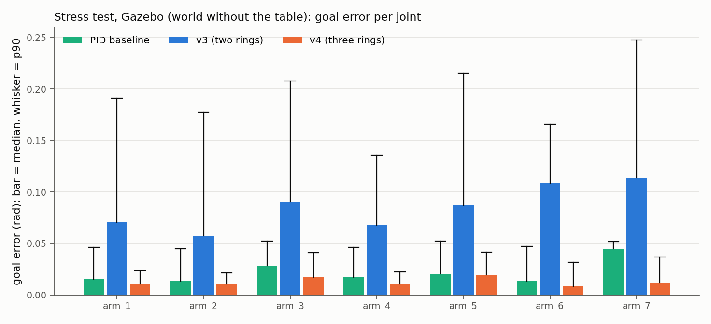
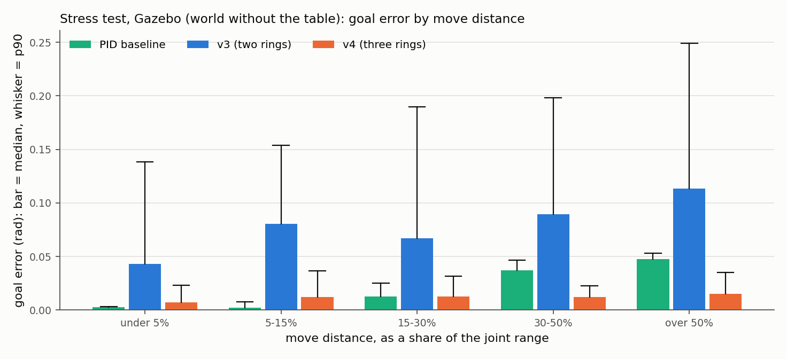
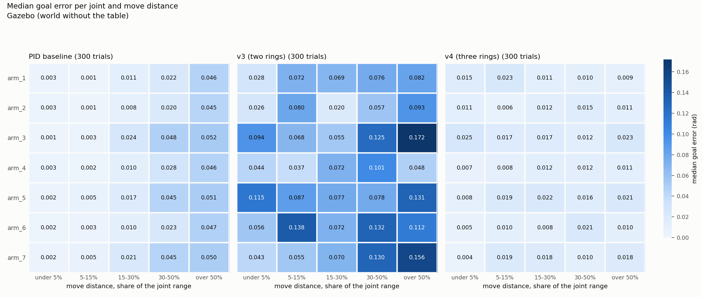
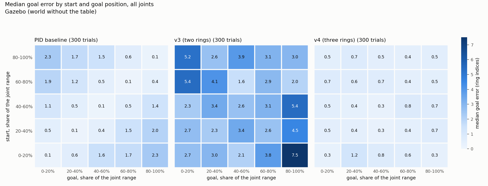
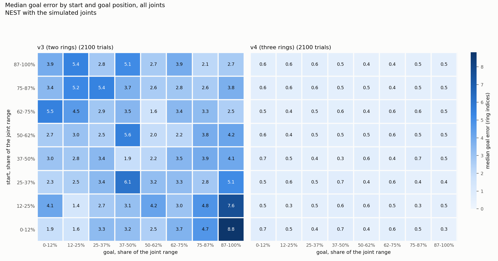

# Stress test: random joint, random arm pose, random goal

Date: 2026-10-04, branch `velocity-calibration`. An add-on to
[`results.md`](results.md), where the goals were a fixed plan and the other six
joints stayed at the reset pose. Here nothing is hand-picked. How to run it:
top-level [`README.md`](../README.md), section 6.1. All tables, with every axis
and percentage explained: [`results/stress/tables.md`](results/stress/tables.md);
every trial: `results/data/stress/`.

## Summary

- **v4 holds up.** Over 300 random trials in Gazebo it ends 0.012 / 0.033 /
  0.060 rad from the goal (median / p90 / max), settles in 99% of them, loses
  no bump and never goes the wrong way.
- **Its error is the same everywhere:** about half a ring index for every
  joint, every move distance and every start and goal position. There is no
  weak region in the heat maps.
- **v3** ends 0.081 / 0.204 / 0.563 rad from the goal and settles in 60% of
  the trials. On the same trials v4 is closer in 93% of them.
- **The PID baseline** ends 0.019 / 0.049 / 0.057 rad from the goal. It is
  more accurate than v4 on short moves (under 15% of the range: 0.002-0.003
  rad against 0.007-0.012) and less accurate on long ones (over 30%:
  0.037-0.048 against 0.012-0.015). Over all trials v4 is closer in 61%.

## What a trial is

1. One seeded plan per simulator: a joint from 0-6, a start and a goal anywhere
   in its range (0-100%, limits included, no minimum distance), an angle for
   each of the other six joints, and a network seed.
2. In Gazebo each draw is checked by MoveIt for self-collision: the pose, the
   straight path to it from the reset pose, and the path of the driven joint.
   62 draws were rejected and drawn again to get 300.
3. Reset motion, base put back, the whole arm moved to the random pose, then
   the controller drives the one joint. The arm reached the planned start to
   within 0.02 rad in every trial of every system.

Gazebo ran in a world without the table (`tiago_ring_stress.world`), because
random arm poses would hit it. No trial moved the robot's base by more than
5 mm. Systems, all on the identical 300 trials: v4 and v3 at 3 NEST steps per
tick, and the PID baseline (the PID of the draft with its fixed gains). On NEST
the simulated joints are independent, so the pose of the other joints changes
nothing there; the 2,100 NEST trials test random joint, start, goal and seed
for v3 and v4.

## Gazebo: 300 random trials per system

| | PID baseline | v3 | v4 |
| --- | --- | --- | --- |
| Goal error, median / p90 / max (rad) | 0.019 / 0.049 / 0.057 | 0.081 / 0.204 / 0.563 | 0.012 / 0.033 / 0.060 |
| The same in ring indices | 0.84 / 2.28 / 2.52 | 3.40 / 8.17 / 18.79 | 0.53 / 1.24 / 2.00 |
| Ends within 0.05 rad | 93% | 32% | 98% |
| Settled (under 0.05 rad for 5 samples) | 100% | 60% | 99% |
| Settling time, median (s) | 1.95 | 2.40 | 2.15 |
| Overshoot, p90 / max (rad) | 0.093 / 0.093 | 0.154 / 0.563 | 0.038 / 0.144 |
| Did not move although the goal was over 0.06 rad away | 0 | 14 | 0 |
| Bumps lost, wrong way, failed resets | - | 0 | 0 |

The PID baseline "settles" in every trial because it passes through the
tolerance band; 7% of its trials then end just outside it (it overshoots and
returns slowly).

### Per joint (bar plot)

### Per move distance (bar plot)

| Move, share of the joint range | Trials | PID baseline, median / p90 (rad) | v3 | v4 |
| --- | ---: | --- | --- | --- |
| under 5% | 26 | 0.003 / 0.003 | 0.043 / 0.138 | 0.007 / 0.023 |
| 5-15% | 47 | 0.002 / 0.007 | 0.080 / 0.154 | 0.012 / 0.037 |
| 15-30% | 81 | 0.013 / 0.025 | 0.067 / 0.190 | 0.013 / 0.032 |
| 30-50% | 70 | 0.037 / 0.046 | 0.090 / 0.198 | 0.012 / 0.023 |
| over 50% | 76 | 0.048 / 0.053 | 0.114 / 0.249 | 0.015 / 0.035 |

The PID baseline's error grows with the distance moved; v4's does not depend
on it. v4 cannot be finer than about half a ring index, so on a short move,
where the PID is nearly exact, v4 is the less accurate one. On long moves the
PID's integral term accumulates while its output is at the 0.5 rad/s limit,
and it parks a little past the goal.

### Heat map 1: joint by move distance

Median goal error in rad; the three panels share one colour scale.

- v4: every cell between 0.004 and 0.025 rad. The larger values are on arm_3,
  arm_5 and arm_7, the joints with the most radians per ring index.
- PID baseline: the same column pattern on every joint, error rising with
  distance.
- v3: no pattern it could be calibrated out of; worst on long moves of the
  wide joints (0.13-0.17 rad).

### Heat map 2: start by goal

Median goal error in ring indices (so that joints with different ranges can
share a map), all joints pooled, start position against goal position.

- v4: 0.3 to 1.2 indices in every cell, including starts and goals at the
  limits.
- PID baseline: small along the diagonal (start near goal), growing away from
  it.
- v3: worst for moves from the low end of the range to the high end (7.5
  indices).

### Where v4 was worst

Four trials did not settle: errors of 0.052 to 0.060 rad on arm_3 and arm_7
(1.5 to 2 ring indices; one index there is 0.030-0.034 rad, so the 0.05 rad
tolerance is under two indices). The ten largest errors are all on arm_3,
arm_5 and arm_7 and are listed with their full poses in
[`results/stress/tables.md`](results/stress/tables.md); the plan file holds
everything needed to rerun one. 14 trials ran to the 20 s step limit although
the joint had arrived and was still. In 6 trials the command was clipped (at
the velocity limit on moves over 2.5 rad, or at a joint limit).

## NEST: 2,100 random trials per system

| | v3 | v4 |
| --- | --- | --- |
| Goal error, median / p90 / max (rad) | 0.078 / 0.207 / 0.649 | 0.012 / 0.031 / 0.078 |
| In ring indices | 3.28 / 8.21 / 21.98 | 0.52 / 1.26 / 3.12 |
| Settled | 64% | 99% |
| Overshoot, p90 / max (rad) | 0.168 / 0.649 | 0.046 / 0.290 |
| Did not move although the goal was over 0.06 rad away | 104 | 1 |
| Wrong way | 1 | 0 |
| Bumps lost | 0 | 0 |

With about 30 trials per cell the v4 map is flat: 0.3 to 0.7 indices
everywhere. The one v4 trial that did not move had a goal 0.060 rad (1.7
indices) away on arm_3. 28 of 2,100 v4 trials did not settle, with errors up
to 0.078 rad (up to 3.1 indices), mostly on the wide joints.

## Upper reference

The two controllers tuned for these joints (section 9 of
[`results.md`](results.md)) were run on the same 300 Gazebo trials; their rows
are in [`results/stress/tables.md`](results/stress/tables.md). The robot's own
controller ended 0.001 / 0.004 / 0.007 rad from the goal. The tuned controller
ended within 0.0005 rad in 299 trials and oscillated in one (trial 249, arm_2),
ending 0.2064 rad off: its gain was tuned on two wrist joints. v4 ended
0.021 rad off on that trial.

## What this does and does not show

- v4's accuracy does not depend on which joint, where in the range, how far,
  which network seed, or how the rest of the arm is posed.
- The limit of v4 is its resolution: half an index in the median, up to two
  indices in the worst Gazebo trials. A finer answer needs more neurons per
  radian.
- The PID baseline was run with the draft's fixed gains; its rising error
  with distance is a property of those gains, not of PID control.
- One joint moves per trial. Several joints driven at once, contact, and the
  real robot were not tested.
- Self-collision screening is MoveIt's; a draw it accepts can still be a pose
  the real arm should not take.
