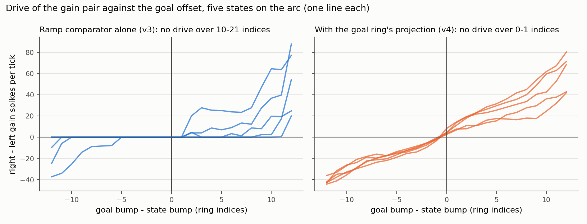

# How architecture v4 was tuned and validated

Date: 2026-10-04, branch `velocity-calibration`. Joints are named
`arm_1`..`arm_7`; the scripts' `--joints` take the 0-based index (arm_6 is 5).
Real NEST `HEAD@41892a5`; Gazebo 11 headless from the pinned image. What v4 is
made of: [`architecture.md`](architecture.md). All systems side by side:
[`results.md`](results.md). This page is the record of how v4 was
measured into shape: what was measured first, every tuning step, what failed,
and the validation.

**Result.** v4 works. In Gazebo, on all seven arm joints and the goals every
other system was run on, the joint ends 0.008 rad from the goal in the median
and 0.022 rad at the 90th percentile (v3: 0.091 / 0.257; the PID baseline:
0.027 / 0.048), and all 56 trials
settle within 0.05 rad (v3: 30 of 56). With the motor gain 30% off, after a
0.2 rad push and after the joint was held for 2 s the p90 error stays at
0.020-0.028 rad (v3: 0.37-1.53). No bump was lost and no trial went the wrong
way in the 1,222 v4 trials recorded up to this validation, nor in the 2,400 of
the stress test. All seven acceptance criteria are met. v4 needs no transport
calibration. The comparison with the PID baseline, and with controllers tuned
for these joints as an upper reference, is in [`results.md`](results.md).

## 1. The idea and the one decision

The idea (architecture v4 drawing): add a ring that holds the joint encoders,
compare the predictive ring with both the goal and the body, and let the
competition of the two comparisons decide how the predictive bump moves.

Built as drawn, with one decision: the two comparisons each have their own
gain pair on the predictive ring, and **only the goal pair drives the robot**.
The alternative, one merged drive for bump and robot, cannot work: bump and
robot would always receive the same command, so a difference between them
could never shrink (measured below: 0.37-0.64 rad of overshoot).

## 2. What was measured before building

All on NEST with the simulated joint, bounded ring, arm_6.

| Question | How | Result |
| --- | --- | --- |
| Where does v3's goal error come from? | Gazebo, all joints, 167 trials of `archive/velocity/all-joints.md`, split into "bump to goal" and "joint to bump" | bump stops away from the goal: median 3.1 indices; joint not on the bump: median 1.5. A joint exactly on the bump would still leave 0.079 rad |
| How fine is the ramp comparator? | `fit_comparator.py map --fine`: bump frozen, goal offset stepped one index at a time, five positions | **no drive in a band 10 to 21 indices wide** (median 13), off-centre by up to 5.5 indices |
| Do bumps stay where they are put? | `fit_comparator.py drift`: free bump for 20 s, five positions, three seeds | -2.1, -1.7 and +1.7 indices, the same at every position: a property of the seed |
| Can the comparison be made sharp? | the goal ring projected onto the gain pair (`map --fine --sharp`) | blind band **0 to 1 index**; the drive grows with the offset |



Consequences: feedback from the body cannot be a second ramp comparison alone
(prediction and body differ by one or two indices, far inside the blind band);
the goal ring must be held against drift; and feedback alone would not have
been enough, because the larger part of v3's error is the comparison itself.

## 3. Tuning on NEST

Rule, written before the sweeps: a setting is out if any bump dies or any
trial goes the wrong way; among the rest the lowest p90 goal error wins, ties
go to the smaller overshoot; with the motor gain 30% off, after a push and
after a hold the p90 must stay within 1.5 times the nominal one.

Trial set unless said otherwise: arm_6, four start poses, nine goals each (36
trials), seed 13579, fake robot (first-order lag, 80 ms). Goal error is
median / p90 / max in rad. Every sweep is in `results/data/tuning.json`
(115 runs).

### 3.1 How hard the body pulls

Starting point: one NEST step per tick, goal ring written once, state ring
written every tick, decoder filter 0.15 s.

| Setting | Goal error | Overshoot p90 / max | Prediction - body at the end (indices) |
| --- | --- | --- | --- |
| v3 at 1x, for reference | 0.119 / 0.353 / 0.425 | 0.156 / 0.280 | - |
| v3 at 3x, for reference | 0.086 / 0.176 / 0.278 | 0.166 / 0.278 | - |
| body pair as strong as the goal pair (feedback weight -0.6) | 0.060 / 0.113 / 0.184 | 0.034 / 0.184 | 4.0 |
| -1.0 | 0.054 / 0.077 / 0.143 | 0.017 / 0.136 | 3.1 |
| -1.5 | 0.024 / 0.050 / 0.120 | 0.024 / 0.125 | 1.7 |
| -2.0 | 0.019 / 0.035 / 0.056 | 0.022 / 0.105 | 1.3 |
| **-3.0** | 0.019 / 0.043 / 0.059 | 0.023 / 0.033 | 0.7 |
| -1.5, body projection inhibition 6e4 instead of 1.5e5 | 0.151 / 0.189 / 0.215 | | 8.1 |
| -1.5, goal pair -1.0 instead of -0.6 | 0.073 / 0.124 / 1.078 | | 4.5 |

The body has to pull several times harder than the goal pushes. With equal
weights the prediction ends 4 indices ahead of the body and the joint stops
that much short.

### 3.2 Holding the goal ring

| Goal ring | Goal error (body weight -2.0) | Goal bump - goal (indices) |
| --- | --- | --- |
| written once | 0.019 / 0.035 / 0.056 | 0.9 |
| **corrective, dead band 2** | 0.009 / 0.022 / 0.035 | 0.3 |
| corrective, dead band 1 | 0.035 / 0.068 / 0.099 | 0.1 |
| written every tick (prototype) | 0.32 median | - |

Writing the goal every tick, or nearly (dead band 1), biases the comparison
(section 3.5 explains why). Dead band 2 removes the drift and leaves the bump
alone otherwise.

### 3.3 Speed and overshoot

Body weight -3.0, goal ring corrective.

| Setting | Goal error | Overshoot p90 / max | Time to 90% (s) |
| --- | --- | --- | --- |
| 1 NEST step per tick | 0.012 / 0.025 / 0.033 | 0.024 / 0.113 | 4.98 |
| 2 | 0.013 / 0.033 / 0.049 | 0.037 / 0.061 | 2.40 |
| 3 | 0.015 / 0.029 / 0.066 | 0.087 / 0.094 | 1.62 |
| 3, decoder filter 0.25 s | 0.016 / 0.027 / 0.033 | 0.152 / 0.159 | 1.85 |
| 3, filter 0.10 s | 0.016 / 0.038 / 0.123 | 0.054 / 0.141 | 1.58 |
| **3, filter 0.05 s** | 0.013 / 0.026 / 0.031 | 0.038 / 0.083 | 1.60 |
| 3, no filter | 0.014 / 0.028 / 0.037 | 0.036 / 0.111 | 1.62 |
| 3, filter 0.15 s, decision-to-gain weight 8000 | 0.011 / 0.026 / 0.037 | 0.044 / 0.047 | 2.30 |

In a closed loop the decoder filter is a delay, and delay is overshoot: 0.05 s
is enough to smooth the command. v4 at 3x covers a move faster than v3 at 3x
(1.6 s against 2.35 s), most likely because its decoder has no transport dead
zone (this was not isolated).

### 3.4 First robustness run: a few trials stall

Body weight -3.0, goal corrective, filter 0.05 s, 3x.

| Condition | Goal error | Largest overshoot |
| --- | --- | --- |
| nominal | 0.013 / 0.026 / 0.031 | 0.083 |
| motor gain x0.7 | 0.014 / 0.031 / **0.142** | 0.035 |
| motor gain x1.3 | 0.014 / 0.032 / 0.064 | 0.242 |
| pushed 0.2 rad | 0.013 / 0.033 / 0.043 | 0.194 |
| held 2 s | 0.016 / 0.029 / **0.296** | 0.044 |

Medians and p90 hold, but one trial in 36 stalled 0.14 rad short and one
0.30 rad short. In those trials the prediction sat on the goal while the state
ring was 7 to 17 indices behind, and the body pair did not pull it back.

### 3.5 Why: a ring that is written every tick biases the ramp comparator

Test (`pull`): joint fixed, prediction started `d` indices away from the body,
goal placed on the prediction so that the goal pair holds it there. Does the
body pair bring the prediction back? Three positions, gaps of 2, 5, 12 and 30
indices to both sides, 3x. Largest remaining gap after 4 s over the 24 cases:

| Body comparison | Largest gap after 4 s (indices) | Median |
| --- | --- | --- |
| ramp comparator + projection, state ring written every tick | 27.3 | (some cases never close) |
| **ramp comparator + projection, state ring corrective (dead band 1)** | **5.7** | 1.1 |
| the same, dead band 2 | 11.8 | 0.7 |
| projection only (no ramp comparator), exc 4e4, weight -1.0 | 33.7 | 7.9 |
| ramp comparator at 30% + projection exc 4e4 | 35.1 | 0.7 |

At index 150 the body pair fired "right" all the time whatever the gap (450
spikes per tick at one NEST step per tick).
A ring that is stimulated every tick fires harder than a free bump; the ramp
comparator's weights rise along the ring, so it reads the extra activity as
"the body is further up", most strongly at high indices. Stimulating only when
the bump is one index off the joint keeps a resting state bump at its free
amplitude. This is also why writing the goal ring every tick failed (3.2).

A body pair made of the projection alone holds the prediction to 0.1 index
while the bumps overlap, but cannot find the prediction again once it is
further away than the projection reaches, so it fails the hold and push tests
whenever its pull is weak (p90 0.43 to 0.74 rad) and one push trial in 36 even
when it is strong. Both mechanisms stay: the ramp comparator for far, the
projection for near.

### 3.6 With the state ring held correctively

| Condition | Goal error | Overshoot p90 / max | Time to 90% (s) |
| --- | --- | --- | --- |
| nominal | 0.010 / 0.015 / 0.021 | 0.040 / 0.101 | 1.60 |
| motor gain x0.7 | 0.008 / 0.023 / 0.040 | 0.022 / 0.025 | 2.55 |
| motor gain x1.3 | 0.009 / 0.018 / 0.027 | 0.081 / 0.253 | 1.20 |
| motor gain x1.6 | 0.007 / 0.022 / 0.037 | 0.170 / 0.337 | 1.00 |
| pushed 0.2 rad | 0.011 / 0.022 / 0.025 | 0.182 / 0.201 | 1.58 |
| pushed -0.4 rad | 0.014 / 0.029 / 0.041 | 0.370 / 0.447 | 1.90 |
| held 2 s | 0.013 / 0.023 / 0.035 | 0.026 / 0.045 | 3.73 |
| seed 7 | 0.009 / 0.021 / 0.030 | 0.038 / 0.059 | 1.65 |
| seed 99 | 0.011 / 0.025 / 0.035 | 0.030 / 0.042 | 1.68 |
| 2 NEST steps per tick | 0.008 / 0.019 / 0.032 | 0.031 / 0.105 | 2.55 |
| 1 NEST step per tick | 0.009 / 0.026 / 0.051 | 0.022 / 0.033 | 4.98 |

No stalled trial under any condition. (The overshoot after a push is the push
itself: it is counted from the goal.)

### 3.7 The joint hunted around the goal

Run to the step limit, a wide joint (arm_5, 0.031 rad per index) kept
moving ±0.04 rad around the goal with a period of about 8 s: the goal pair
fires 15 to 20 spikes per tick as soon as the prediction is one index off, the
state ring only reports the joint in steps of one index, and the loop cycles.
A small dead zone in the decoder ends it. arm_6 and arm_5, three starts, six
goals each (36 trials); "range at the end" is how much the joint still moves
in the last 2 s of the trial:

| Decoder dead zone (spikes per NEST step) | Goal error (indices) | Range at the end, median / p90 (rad) | Overshoot p90 / max | Trials at the step limit |
| --- | --- | --- | --- | --- |
| 0 | 0.49 / 1.14 / 1.46 | 0.017 / 0.032 | 0.047 / 0.062 | 0 |
| **3** | 0.23 / 1.10 / 1.36 | 0.004 / 0.006 | 0.028 / 0.039 | 0 |
| 5 | 0.45 / 1.16 / 2.11 | 0.001 / 0.005 | 0.018 / 0.030 | 4 |
| 7 | 0.56 / 2.19 / 2.43 | 0.000 / 0.001 | 0.002 / 0.012 | 0 |
| 10 | 1.21 / 1.91 / 3.05 | 0.000 / 0.003 | 0.000 / 0.000 | 14 |

Three spikes per step stops the hunting and costs nothing (the median error
even halves, because the joint no longer wanders off the goal). Ending trials
sooner (`n_settle` 15 instead of 40 ticks) cut some trials off in the middle
of a move.

### 3.8 What was tried and dropped

| Tried | Result |
| --- | --- |
| Decision-to-gain weight 1.5e4 (prototype) | far moves fire 600-1100 gain spikes per tick, the joint outruns the bump and the bump dies in 5 of 36 trials |
| The robot driven from a gain pair on the state ring | overshoot 0.37-0.64 rad |
| The state ring coupled straight into the predictive ring | too weak to correct |
| A refractory cap on the gain neurons | costs accuracy |
| Body projection excitation 4e4 with the ramp comparator | far gaps no longer close |
| Lower state-encoder rate (100 Hz) instead of corrective holding | the bias stays |

## 4. The settings chosen

`FEEDBACK` in `graph/templates.py`:

```python
motor_gain=0.005266, tau_s=0.05, dead_zone=3.0, drive_threshold=5.0, n_settle=40,
homeostasis_gain_weight=10000.0, body_homeostasis_gain_weight=10000.0,
goal_feedback_weight=-0.6, body_feedback_weight=-3.0,
goal_reference=dict(exc_weight=2.0e4, inh_weight=6.0e4, window=10),
body_reference=dict(exc_weight=2.0e4, inh_weight=1.5e5, window=10),
goal_mode="corrective", goal_dead_band=2,
state_mode="corrective", state_dead_band=1, state_rate_hz=200.0,
time_scale=3,
```

`motor_gain` is the bump travel per gain spike that the transport calibration
of v3 found (0.005266 indices per spike). In v4 it is a loop gain and nothing
is fitted: ±30% changes the speed and the overshoot, not the goal error.

## 5. Validation on NEST

All seven joints, three start poses, three seeds, eight goals: 504 trials per
system. Disturbances on arm_2, arm_5, arm_6 (48 trials each). From
[`results/tables.md`](results/tables.md), section 7.

| condition | system | trials | goal error, median / p90 / max (rad) | settled | overshoot, p90 / max (rad) | time to 90%, median (s) | bumps lost | wrong way |
|---|---|---:|---|---:|---|---:|---:|---:|
| all joints, 3 starts x 3 seeds x 8 goals | v3 | 504 | 0.063 / 0.194 / 0.531 | 65% | 0.117 / 0.306 | 2.10 | 0 | 0 |
| all joints, 3 starts x 3 seeds x 8 goals | v4 | 504 | 0.011 / 0.027 / 0.050 | 100% | 0.031 / 0.136 | 1.55 | 0 | 0 |
| motor gain x0.7 (arm_2, arm_5, arm_6) | v3 | 48 | 0.245 / 0.636 / 1.088 | 6% | 0.000 / 0.000 | 2.08 | 0 | 0 |
| motor gain x0.7 (arm_2, arm_5, arm_6) | v4 | 48 | 0.010 / 0.027 / 0.045 | 100% | 0.019 / 0.029 | 2.70 | 0 | 0 |
| motor gain x1.3 (arm_2, arm_5, arm_6) | v3 | 48 | 0.151 / 0.458 / 0.789 | 52% | 0.515 / 0.797 | 2.08 | 0 | 0 |
| motor gain x1.3 (arm_2, arm_5, arm_6) | v4 | 48 | 0.014 / 0.036 / 0.056 | 98% | 0.079 / 0.215 | 1.10 | 0 | 0 |
| push 0.2 rad (arm_2, arm_5, arm_6) | v3 | 48 | 0.239 / 0.357 / 0.512 | 12% | 0.306 / 0.467 | 2.10 | 0 | 0 |
| push 0.2 rad (arm_2, arm_5, arm_6) | v4 | 48 | 0.011 / 0.024 / 0.029 | 100% | 0.184 / 0.197 | 1.85 | 0 | 0 |
| held 2 s (arm_2, arm_5, arm_6) | v3 | 48 | 0.330 / 1.126 / 1.903 | 12% | 0.000 / 0.009 | 1.00 | 0 | 0 |
| held 2 s (arm_2, arm_5, arm_6) | v4 | 48 | 0.007 / 0.015 / 0.026 | 100% | 0.025 / 0.058 | 3.83 | 0 | 0 |
| goals exactly at the joint limits (arm_3, arm_6) | v3 | 12 | 0.167 / 0.301 / 0.481 | 17% | 0.000 / 0.000 | 2.20 | 0 | 0 |
| goals exactly at the joint limits (arm_3, arm_6) | v4 | 12 | 0.011 / 0.023 / 0.039 | 100% | 0.000 / 0.000 | 1.85 | 0 | 0 |
| time scale 1 (arm_5, arm_6) | v3 | 48 | 0.074 / 0.311 / 0.628 | 62% | 0.101 / 0.269 | 5.65 | 0 | 0 |
| time scale 1 (arm_5, arm_6) | v4 | 48 | 0.010 / 0.030 / 0.104 | 94% | 0.021 / 0.033 | 5.43 | 0 | 0 |
| time scale 2 (arm_5, arm_6) | v3 | 48 | 0.086 / 0.203 / 0.311 | 65% | 0.117 / 0.267 | 3.03 | 0 | 0 |
| time scale 2 (arm_5, arm_6) | v4 | 48 | 0.011 / 0.035 / 0.060 | 98% | 0.019 / 0.084 | 2.48 | 0 | 0 |

In ring indices v4 ends 0.49 / 1.04 / 1.47 from the goal on every joint (v3:
2.68 / 7.38 / 15.49): the remaining error is the resolution of the ring, about
one index, which is 0.02 rad on arm_6 and 0.034 rad on arm_3.

## 6. Validation in Gazebo

Up to six simulations in parallel, each trial starting from the reset motion with
the robot's base put back at its spawn pose. Full tables:
[`../results/tables.md`](results/tables.md); reading and figures:
[`results.md`](results.md).

| Set | Trials | v3: goal error, median / p90 / max (rad) | v3 settled | v4: goal error | v4 settled |
| --- | ---: | --- | ---: | --- | ---: |
| all joints, 8 goals from the reset pose | 56 | 0.091 / 0.257 / 0.344 | 54% | 0.008 / 0.022 / 0.045 | 100% |
| all joints, three start poses, 8 goals each | 168 | 0.063 / 0.195 / 0.359 | 62% | 0.012 / 0.029 / 0.075 | 98% |
| arm_2, arm_5, arm_6, six goals (nominal) | 18 | 0.069 / 0.202 / 0.286 | 50% | 0.011 / 0.019 / 0.046 | 100% |
| the same, motor gain x0.7 | 18 | 0.314 / 0.662 / 1.215 | 6% | 0.013 / 0.028 / 0.039 | 100% |
| the same, motor gain x1.3 | 18 | 0.203 / 0.855 / 0.950 | 33% | 0.010 / 0.022 / 0.024 | 100% |
| the same, pushed 0.2 rad | 18 | 0.234 / 0.373 / 0.485 | 11% | 0.009 / 0.020 / 0.031 | 100% |
| the same, held 2 s | 18 | 0.533 / 1.530 / 2.224 | 0% | 0.007 / 0.023 / 0.038 | 100% |
| all joints at 1x | 56 | 0.088 / 0.231 / 0.363 | 66% | 0.009 / 0.060 / 0.140 | 88% |
| stress test: random joint, arm pose and goal | 300 | 0.081 / 0.204 / 0.563 | 60% | 0.012 / 0.033 / 0.060 | 99% |

Where the three bumps end in Gazebo (comparison set, ring indices, median /
p90): prediction to state ring 0.31 / 0.95; prediction to goal bump
0.38 / 1.23; goal bump to the goal's index 0.50 / 0.98. Time to 90% of a move:
1.88 s (v3 at 3x: 2.33 s; the PID baseline: 2.10 s). Overshoot
p90 / max: 0.023 / 0.050 rad (v3: 0.206 / 0.344). The numbers agree with NEST (section 5), so the simulated
joint was a fair place to tune.

## 7. Acceptance criteria

Written before the runs (plan of 2026-10-04); "v3" is the bounded ring at 3x.

| criterion | target | v3 | v4 | met |
|---|---|---|---|---|
| bumps lost, wrong-way or clamped trials | 0 | 2 | 0 | yes |
| goal error, all joints, median / p90 | <= 0.045 / 0.12 rad (2 / 4.5 indices) | 0.091 / 0.257 rad | 0.008 / 0.022 rad (0.4 / 1.0 indices) | yes |
| goal error p90 with the motor gain x0.7 / x1.3 | within 1.5x of the nominal p90 (0.019 rad) | x0.7: 0.662, x1.3: 0.855 | x0.7: 0.028, x1.3: 0.022 | yes |
| predicted bump - goal bump at rest, median | <= 1 index | 1.9 (bump - goal) | 0.38 | yes |
| goal bump - goal index at rest, median | <= 1 index | drifts 2-5 | 0.50 | yes |
| time to 90% of the move, median | <= 1.5x of v3 at the same time scale | 2.33 s | 1.88 s | yes |
| goal error p90 after a 0.2 rad push | back within the nominal error (0.019 rad p90) | 0.373 | 0.020 | yes |

## 8. What v4 does not do

- **A controller tuned for these joints is more exact, faster and more
  repeatable.** It ends within 0.0005 rad and settles in 0.85 s; v4 ends
  within 0.045 rad and settles in 2.35 s ([`results.md`](results.md), section 9).
- **It is not more exact than one ring index.** The remaining error is about
  0.4 index in the median and 1 index at p90: 0.02 rad on most joints, 0.03 rad
  on arm_3, arm_5 and arm_7. A finer answer needs more neurons per radian (a
  larger ring or a narrower arc), not more tuning.
- **It does not repeat exactly.** Three runs of the same goal end within
  0.013 rad of each other in the median (largest 0.027); the open-loop systems
  repeat to under 0.001 rad.
- **At one NEST step per tick it is slow and its tail is worse.** 7 of 56
  Gazebo trials at 1x ended 0.055-0.14 rad short: the joint creeps over the last
  indices and the "no more drive for 2 s" rule ends the trial first. 2x and 3x
  do not show this.
- **A wrong motor gain costs overshoot, not accuracy.** At x1.3 the joint
  overshoots by up to 0.36 rad before it settles (p90 0.20); at x1.6 on NEST
  by 0.34. The loop was not tested beyond that.
- **About one trial in fifty runs to the step limit** although the joint has
  arrived and is still: the goal pair keeps firing just above the "settled"
  threshold. It costs trial time only.
- **The ring-to-gain projection and the second gain pair are new connectivity**
  that the paper's model does not have. They exist only in the three-ring
  graph; v3 still reproduces the paper's architecture.
- **One joint per network**, as before: the multi-joint template is still v3.
- **Simulation only.** Nothing was run on the robot; the simulated position
  controller follows its command with 5-14 ms of lag.

## 9. How to reproduce

```bash
# the measurements of section 2
python3 -B scripts/fit_comparator.py map --fine --bounds bounded --out /out/fine
python3 -B scripts/fit_comparator.py map --fine --sharp --bounds bounded --out /out/sharp
python3 -B scripts/fit_comparator.py drift --bounds bounded --out /out/drift

# one tuning sweep of section 3 (the 36-trial set), about 2 minutes
python3 -B scripts/validate_velocity.py --engines nest --systems F --joints 5 --starts 0.15 0.38 0.6 0.8 --trials 9 \
    --feedback body_feedback_weight=-2.0 --feedback state_mode=continuous --out /out/sweep
# add --motor-gain-scale 0.7, --push 0.2 or --hold 2 for the robustness rows

# section 5 (per joint; about 6 minutes each)
python3 -B scripts/validate_velocity.py --engines nest --systems B F --joints 5 --starts 0.25 0.5 0.75 --seeds 13579 7 99 --trials 8 --out /out/nest_j5

# section 6: the top-level README, section 6
```

Gates in the test suite: `test/test_feedback_v4.py` (wiring, the projection's
synapse pattern, disturbances, on the fakes) and
`test/test_feedback_v4_real_nest.py` (real NEST: goals reached within the
settling tolerance with the motor gain x0.7, x1.0 and x1.3, after a push and
after a hold, no bump lost; blind band of the projection at most 2 indices).
